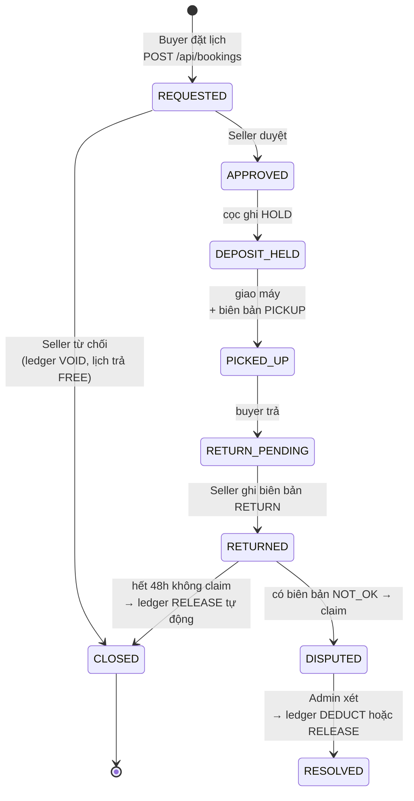
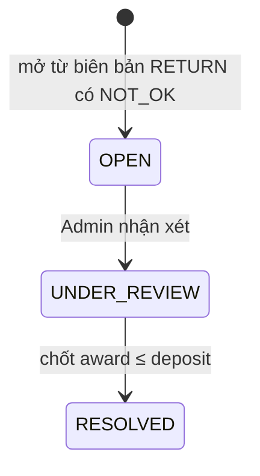

# GearLoop — Mô hình dữ liệu

Tài liệu mô tả **toàn bộ cấu trúc database**: có những bảng nào, mỗi cột nghĩa
là gì, các bảng nối với nhau ra sao, và dữ liệu chuyển trạng thái như thế nào.

Nguồn sự thật là `prisma/schema.prisma`. Nếu schema thay đổi, tài liệu này
phải cập nhật theo (quy tắc trong `AGENTS.md`).

Xem thêm: [prod.md](./prod.md) · [backend-flows.md](./backend-flows.md) · [adr/](./adr/)

---

## 1. Bức tranh tổng thể

GearLoop có **16 bảng**, chia 4 nhóm:

| Nhóm | Bảng | Bản chất |
| --- | --- | --- |
| **Con người** | `users` | Ai đăng nhập, vai trò nào |
| **Danh mục** (ít đổi) | `categories`, `checklist_template_items`, `policy_settings` | Cấu hình vận hành, Admin khai một lần |
| **Tài sản** (nền kinh tế của app) | `items`, `item_photos`, `rate_tiers`, `deposit_policies`, `calendar_days` | Thiết bị, giá theo ngày, % cọc, lịch ngày |
| **Giao dịch** (đổi liên tục) | `bookings`, `condition_reports`, `condition_report_entries`, `damage_claims`, `deposit_ledgers`, `reviews`, `audit_logs` | Trái tim của app — lượt thuê và vòng đời của nó |

Hiểu nhanh bằng một câu:

> Một **Chủ thiết bị** đăng một **Item** thuộc một **Category**, kèm bảng giá
> theo ngày và % cọc. Lịch cho thuê được biểu diễn bằng **CalendarDay** — mỗi
> ngày một dòng. **Buyer** đặt một **Booking** chiếm các dòng lịch đó và cọc
> được ghi vào **DepositLedger**. Hai **ConditionReport** (nhận/trả) là chứng
> cứ; hư hỏng sinh ra **DamageClaim** do Admin xét.

---

## 2. Sơ đồ quan hệ (ERD)

```mermaid
erDiagram
    USERS            ||--o{ ITEMS : "sở hữu"
    CATEGORIES       ||--o{ ITEMS : "phân loại"
    CATEGORIES       ||--o{ CHECKLIST_TEMPLATE_ITEMS : "mẫu biên bản"
    ITEMS            ||--o{ ITEM_PHOTOS : ""
    ITEMS            ||--o{ RATE_TIERS : "giá theo số ngày"
    ITEMS            ||--o| DEPOSIT_POLICIES : "% cọc"
    ITEMS            ||--o{ CALENDAR_DAYS : "1 dòng / ngày"
    USERS            ||--o{ BOOKINGS : "thuê"
    ITEMS            ||--o{ BOOKINGS : "được thuê"
    BOOKINGS         ||--o{ CONDITION_REPORTS : "PICKUP | RETURN"
    CHECKLIST_TEMPLATE_ITEMS ||--o{ CONDITION_REPORT_ENTRIES : ""
    CONDITION_REPORTS ||--o{ CONDITION_REPORT_ENTRIES : ""
    BOOKINGS         ||--o{ DAMAGE_CLAIMS : ""
    BOOKINGS         ||--o{ DEPOSIT_LEDGERS : "append-only"
    BOOKINGS         ||--o| REVIEWS : "1 review / booking"
    USERS            ||--o{ AUDIT_LOGS : "actor"

    USERS {
        serial  id PK
        varchar email UK
        varchar password_hash "bcrypt"
        varchar role "ADMIN | SELLER | BUYER"
        boolean is_active
    }
    CATEGORIES {
        serial  id PK
        varchar name UK
    }
    CHECKLIST_TEMPLATE_ITEMS {
        serial  id PK
        int     category_id FK
        varchar label
        boolean required
    }
    ITEMS {
        serial  id PK
        int     owner_id FK
        int     category_id FK
        varchar title
        int     replacement_value_vnd
        varchar status "ACTIVE | ARCHIVED | SUSPENDED"
    }
    RATE_TIERS {
        serial id PK
        int    item_id FK
        int    min_days
        int    max_days "NULL = trần mở"
        int    price_per_day_vnd
    }
    DEPOSIT_POLICIES {
        serial id PK
        int    item_id FK UK
        int    percent "% cọc, chặn bởi policy"
    }
    CALENDAR_DAYS {
        serial id PK
        int    item_id FK
        date   date
        varchar kind "FREE | BOOKED | BLOCKED"
        int    booking_id FK "NULL nếu không BOOKED"
    }
    BOOKINGS {
        serial id PK
        int    item_id FK
        int    buyer_id FK
        date   start_date
        date   end_date
        varchar status "9 trạng thái — mục 5"
        int    total_vnd "snapshot"
        int    deposit_vnd "snapshot"
    }
    CONDITION_REPORTS {
        serial id PK
        int    booking_id FK
        varchar phase "PICKUP | RETURN"
        int    reporter_id FK
    }
    DAMAGE_CLAIMS {
        serial id PK
        int    booking_id FK
        varchar status "OPEN | UNDER_REVIEW | RESOLVED"
        int    amount_awarded_vnd "Admin quyết"
    }
    DEPOSIT_LEDGERS {
        serial id PK
        int    booking_id FK
        varchar type "HOLD | RELEASE | DEDUCT | VOID"
        int    amount_vnd
    }
```

### Hai quan hệ dễ nhầm, giải thích kỹ

**a) `calendar_days` không trỏ thẳng `bookings` bắt buộc.** `booking_id` chỉ
được set khi `kind = BOOKED`; ngày `BLOCKED` (bảo trì) và `FREE` để NULL.
Cột này phục vụ truy ngược "ngày này thuộc booking nào" mà không cần khoảng
ngày logic nào khác.

**b) `bookings` lưu snapshot tiền (`total_vnd`, `deposit_vnd`)** thay vì tính
lại từ `rate_tiers`/`deposit_policies` lúc đọc. Chủ thiết bị có quyền sửa
giá — lượt thuê đã chốt phải giữ nguyên con số thời điểm đặt, nếu không sổ
cọc sẽ lệch với tiền đã ghi.

---

## 3. Từ điển dữ liệu (chỉ các cột có nghiệp vụ)

Ký hiệu: **PK** khóa chính · **FK** khóa ngoại · **UK** unique.

### 3.1. `users`

| Cột | Kiểu | NULL? | Mặc định | Khóa | Ý nghĩa |
| --- | --- | --- | --- | --- | --- |
| `id` | `serial` | Không | tự tăng | PK | Mã tài khoản |
| `email` | `varchar` | Không | - | UK | Đăng nhập |
| `password_hash` | `varchar` | Không | - | | bcrypt — **không bao giờ trả về client** (ADR-002) |
| `full_name` | `varchar` | Không | - | | Tên hiển thị |
| `role` | `enum` | Không | `BUYER` | | `ADMIN \| SELLER \| BUYER` — đúng 3 vai trò (ADR-007) |
| `is_active` | `boolean` | Không | `true` | | Admin khoá → chặn đăng nhập |

### 3.2. `items`

| Cột | Kiểu | NULL? | Mặc định | Khóa | Ý nghĩa |
| --- | --- | --- | --- | --- | --- |
| `owner_id` | `int` | Không | - | FK → users | Chủ thiết bị |
| `category_id` | `int` | Không | - | FK → categories | Quyết định checklist biên bản |
| `title`, `description` | `varchar/text` | Không/Có | - | | Nội dung tin đăng |
| `replacement_value_vnd` | `int` | Không | - | | Giá trị thay thế — nền tính cọc |
| `status` | `enum` | Không | `ACTIVE` | | `ARCHIVED` ẩn khỏi tìm kiếm; `SUSPENDED` do Admin |

### 3.3. `rate_tiers` + `deposit_policies`

| Cột | Ý nghĩa |
| --- | --- |
| `min_days` / `max_days` | Khoảng ngày áp giá. `max_days NULL` = trần mở. `UNIQUE(item_id, min_days)` |
| `price_per_day_vnd` | Giá/ngày trong khoảng |
| `percent` | % cọc trên `replacement_value_vnd`, chặn trên bởi `policy_settings.deposit_cap_percent` |

### 3.4. `calendar_days` — bảng quan trọng thứ hai

| Cột | Kiểu | NULL? | Mặc định | Khóa | Ý nghĩa |
| --- | --- | --- | --- | --- | --- |
| `item_id` | `int` | Không | - | FK → items | Của thiết bị nào |
| `date` | `date` | Không | - | | Một ngày lịch (UTC) |
| `kind` | `enum` | Không | `FREE` | | `FREE` trống · `BOOKED` đang thuê · `BLOCKED` chủ chặn |
| `booking_id` | `int` | Có | `NULL` | FK → bookings | Chỉ set khi `kind = BOOKED` |

**Ràng buộc:**

```sql
UNIQUE (item_id, date)
```

---

## 4. Ràng buộc quan trọng nhất: chống đặt chồng

```sql
UNIQUE (item_id, date)   -- Prisma: @@unique([itemId, date])
```

> "Một thiết bị, một ngày lịch, **chỉ tồn tại đúng một dòng**."

### Vì sao là unique thay vì partial unique index?

Template MedBook dùng **partial unique index** (`WHERE status IN (...)`) vì
bảng của họ chỉ tạo dòng `appointments` khi có người đặt, và lịch đã hủy vẫn
nằm lại. GearLoop ngược lại: **dòng lịch luôn tồn tại cho mọi ngày** (60 ngày
tới), đặt/hủy chỉ **đổi `kind`**:

| Kịch bản | Với `UNIQUE(item_id, date)` |
| --- | --- |
| An đặt ngày 14/11 → hủy | Dòng 14/11 đổi `BOOKED → FREE`. Linh đặt lại bình thường |
| Hai buyer đặt cùng ngày | Cả hai UPDATE/INSERT cùng dòng → dòng thứ hai bị **DB từ chối** |
| Script chèn thẳng vào DB quên check | Vẫn bị chặn — unique không có đường vòng |

Nguyên tắc mirror từ [ADR-004 của template](https://github.com/NgDucLoc/MedBook-Case-Study-Base/blob/main/doc/adr/004-transaction-lock-booking.md):
*quy tắc nghiệp vụ sống còn thì đặt ở cả code lẫn database.* Trong
`bookingService.createBooking()` có check availability để trả lỗi 409 thân
thiện; `UNIQUE(item_id, date)` là lớp bảo vệ cuối mà không đường code nào vượt qua.

Đặt booking là **một transaction** gồm 3 ghi: tạo `Booking(REQUESTED)` → đổi
các dòng `CalendarDay` sang `BOOKED` (+ `booking_id`) → ghi
`DepositLedger(HOLD)`. Có điều kiện nào thất bại → rollback toàn bộ.

---

## 5. Vòng đời dữ liệu (State Machine)

### 5.1. Vòng đời `bookings`



### 5.2. Bảng chuyển trạng thái (trích)

| Từ | Sang | Ai được làm | Điều kiện / Vi phạm |
| --- | --- | --- | --- |
| (mới) | `REQUESTED` | Buyer | Ngày không FREE → `409` |
| `REQUESTED` | `APPROVED` | Seller (chủ item) | Buyer tự duyệt → `403` |
| `REQUESTED` | `CLOSED` | Seller | Lịch trả `FREE`, ledger `VOID` |
| `APPROVED` | `PICKED_UP` | Seller | Phải có biên bản `PICKUP` đầy đủ mục required |
| `RETURNED` | `CLOSED` | **Hệ thống** (timer) | Không claim trong `claim_window_hours` → `RELEASE` |
| `RETURNED` | `DISPUTED` | Seller hoặc Buyer | Claim mới chỉ khi biên bản RETURN có `NOT_OK` |
| `DISPUTED` | `RESOLVED` | Admin | Award ≤ `deposit_vnd`; ghi `DEDUCT` + phần nhả lại |
| `CLOSED` | bất kỳ | **Không ai** | Trạng thái chết |

Ba điều cần nhớ:

1. `CLOSED` là **trạng thái chết** — thuê lại phải tạo booking mới.
2. Chuyển trạng thái là **UPDATE có điều kiện**:
   `UPDATE bookings SET status='APPROVED' WHERE id=$1 AND status='REQUESTED' RETURNING id`
   — không trả dòng nào nghĩa là state sai → ném `409`. Không có khe hở thời gian.
3. Timer nhả cọc và auto-suspension là **so sánh timestamp thuần** — không ML (giới hạn môn học).

### 5.3. Vòng đời `damage_claims`



---

## 6. Hạn chế đã biết

- `item_photos.url` là URL ngoài — **không có xác minh ảnh tự động** (cấm AI/CV);
  độ tin cậy dựa vào slot ảnh bắt buộc theo checklist + Admin xét khiếu nại.
- Tiền cọc là **sổ ghi nội bộ** (`deposit_ledgers`) — chưa nối cổng thanh toán.
- Toàn bộ thời gian xử lý theo **UTC**; UI hiển thị giờ Việt Nam (+07).
- `audit_logs` chiếm chỗ theo thời gian — chưa có archival (ngoài phạm vi môn học).
