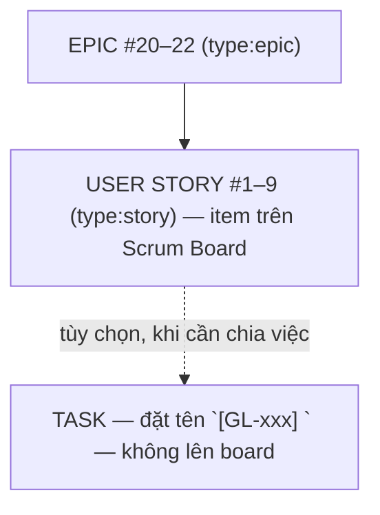

# GearLoop — Lộ trình Scrum 6 tuần

Team 8 người · 4 pod · 6 sprint × 1 tuần · deploy từ Sprint 1.

| Sprint | Ngày | Chủ đề | Mốc chính |
| --- | --- | --- | --- |
| S1 | 27/10–2/11 | Walking skeleton | Auth + RBAC + Item CRUD; **URL live ngày 3** |
| S2 | 3–9/11 | Core loop | Booking end-to-end + sổ cọc; alpha nội bộ |
| S3 | 10–16/11 | Sad paths + Beta | Claim/claim xét xử, chặn ngày, huỷ; **mở beta lớp** |
| S4 | 17–23/11 | Fix the beta | ~70% sửa bug beta, ~30% CRUD depth; beta vòng 2 |
| S5 | 24–30/11 | Harden & docs | Seed demo, test case trắng/đen hộp (Labs 11–12) |
| S6 | 1–7/12 | Freeze & demo | Đóng băng thứ 3; chỉ P0; rehearsal; thuyết trình |

## Pods

| Pod | Người | Sở hữu |
| --- | --- | --- |
| A | 2 | auth/RBAC/user + CI/CD |
| B | 3 | domain + schema (1 DB OWNER) |
| C | 2 | booking/claim/ledger + admin dashboards |
| D | 1 | QA + seed + docs + beta triage |

Review chéo A↔B↔C↔D, không tự review. PR ≤ ~300 dòng.

## Ceremonies (~4 giờ/tuần)

- **Mon 30′** planning · **Daily 10–15′** standup · **Wed 15′** grooming ·
  **Fri 45′** review + retro + kiểm tra deploy URL.

## Definition of Done

CI xanh → 1 approval (không phải tác giả) → squash merge → thấy trên URL
production → tác giả smoke test + screenshot trong PR.

## Sprint exit gate

Sprint chỉ xong khi URL production chạy được goal của sprint end-to-end.
Chi tiết từng story: [sprint-1.md](./sprint-1.md) (các sprint sau do PO cập nhật sau planning).

## Working agreement — GitHub Projects board

Project **GearLoop Scrum Board** (org project `https://github.com/orgs/BTL-IT3180/projects/5` — GITHUB_TOKEN chỉ tự động hoá được project org) quản lý trạng thái bằng 1 field duy nhất:

**Status (6 cột, theo thứ tự luồng):** `Product Backlog → Ready for Sprint → To Do → In Progress → In Review/QA → Done`

- Mỗi issue có **Area pod** (4 pod), **Priority** (Urgent/High/Medium/Low), **Estimate** (Fibonacci 1/2/3/5/8/13) và **Sprint** (iteration 7 ngày, bắt đầu 27/10/2026).
- **Sprint mặc định cho story mới = "Ready for Sprint"** (đã backlog-refined, đủ AC + estimate, chờ planning gắn Sprint).
- Không dùng nhãn trạng thái trùng lặp trên issue — Status trên board là nguồn sự thật duy nhất.
- Story tạo từ template luôn có Estimate + Area pod → không story nào "to" hơn 1 ngày; vượt → tách story ở grooming.

**4 view chuẩn (đã tạo sẵn):**

| View | Layout | Filter | Dùng khi |
|---|---|---|---|
| Product Backlog | Table | `-Sprint:@current -status:Done` | Grooming, xếp hạng backlog |
| Current Sprint | Board (cột = Status) | `Sprint:@current` | Làm việc hằng ngày trong sprint |
| Next Sprint | Table | `Sprint:@current+1` | Chuẩn bị planning đầu sprint mới |
| Daily Standup | Table | `Sprint:@current` | Daily 10–15′, group theo Assignee |

**Tự động hoá** (`.github/workflows/project-automation.yml`, dùng `GITHUB_TOKEN`):

- Issue mới/reopen → tự vào board cột **Product Backlog**.
- PR mở/ready (issues được link qua `Closes #n`) → **In Review/QA**.
- PR merge → **Done**.

Nghĩa vụ của người làm story: kéo **To Do → In Progress** khi bắt đầu, **In Progress → In Review/QA** sẽ tự khi mở PR — không tự kéo sang Done, để merge tự chuyển.

## Operating manual — chuẩn hoá theo khoá học "Scrum with GitHub Projects" (Benjamin Day)

Khoá học gốc dựng bằng GitHub Projects đời cũ; dưới đây là bản hiện đại hoá lên Projects v2 đã cấu hình xong trên repo + org project này.

### Cấu trúc work item — story là nơi tổng hợp, task sub-issue là tùy chọn

- **Story** = đơn vị theo dõi chính: **checklist AC trong body story là nguồn sự thật** — tick trực tiếp khi làm xong.
- **Task sub-issue** chỉ mở khi story cần chia việc nhỏ (ví dụ #55–57 của GL-107). Quy tắc đặt tên: `[GL-xxx] <mô tả AC>` — dùng đúng thuật ngữ hồ sơ (Item · Booking · DepositTransaction · ConditionReport · Người thuê/Chủ đồ/Quản trị viên); body dẫn về story; **không đưa lên board**; xong → tick AC trong story rồi đóng task.
- **Epic** = cụm story cùng pod (A/B/D), link sub-issues để thấy tiến độ tổng; không có estimate.
- Quyết định 26/10: xoá 25 task trùng AC (không prefix, không truy vết về story). Task mở lại sau này PHẢI theo convention ở trên.

### Labels (repo) — 2 trục

| Nhóm | Giá trị | Dùng cho |
|---|---|---|
| Loại | `type:epic` · `type:story` · `type:chore` · `bug` · `documentation` | Phân loại work item |
| Pod | `area:auth-ci` · `area:domain-schema` · `area:transaction-admin` · `area:qa-docs` | Khớp 1:1 với field `Area pod` trên board |
| Trạng thái | `blocked` (ghi issue chặn trong body) |flags ngoài board |

### Sprint = Milestone (repo) + Iteration (board)

- Milestone `Sprint 1…6` (due 2/11 → 7/12, cách nhau 7 ngày) — dùng lọc repo-level; **9 story S1 đã gắn Sprint 1**.
- Khi field **Sprint (iteration)** được tạo trên board (xem UI checklist dưới) — iteration là nguồn sự thật cho view `@current`; milestone giữ lại để lọc trong repo/PR list.

### Views board (8): 4 view chuẩn + 4 view pod

`Product Backlog` · `Current Sprint` (board) · `Next Sprint` · `Daily Standup` — xem bảng ở trên.
Mới: `Pod A—D` (table, lọc `area:<pod> -status:Done`) — mỗi pod mở đúng view của mình trong standup.

### Checklist UI (tính năng Projects v2 không tạo được qua API — ~5 phút một lần)

1. **Field iteration `Sprint`**: board → `+ New field` → Iteration · start 27/10 · 7 ngày · 8 iterations → bulk set 9 story = S1 → group-by 4 view (Current/Next/Standup + Product Backlog group Status).
2. **Insights**: New insight → chart X=Status, Y=Count cho burn-down; chart 2: X=Sprint, Y=Estimate sum cho velocity.
3. **Org project template**: Settings org → Projects → Templates → *New from project* → chọn GearLoop Scrum Board (sau khi board hoàn chỉnh).
4. **CODEOWNERS + teams pod**: tạo sau khi có username của 4 thành viên (tránh blocker review khi team rỗng).

### Automation — trạng thái

Workflow `project-automation.yml` đã chuẩn (issue→Backlog, PR→In Review/QA, merge→Done) nhưng **GITHUB_TOKEN không ghi được Projects v2** (giới hạn của GitHub, không phụ thuộc policy org). Cần secret `PROJECT_PAT` (fine-grained PAT chỉ có quyền Projects:write) — workflow đã wire sẵn `${{ secrets.PROJECT_PAT || secrets.GITHUB_TOKEN }}`.
