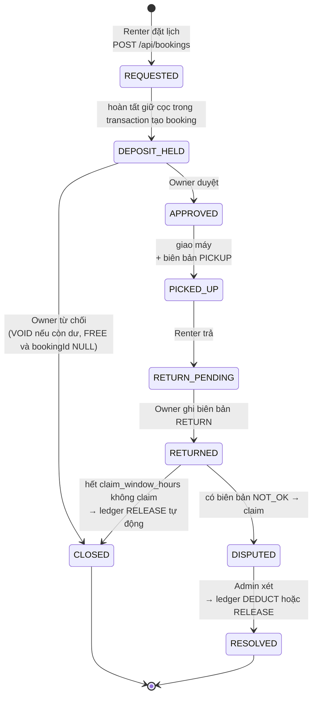
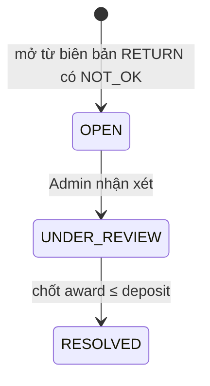

# GearLoop — Mô hình dữ liệu

Tài liệu mô tả 16 bảng, các cột nghiệp vụ chính, quan hệ giữa các bảng và
vòng đời dữ liệu. Danh sách field đầy đủ nằm trong schema Prisma.

`prisma/schema.prisma` là nguồn đối chiếu cấu trúc model, field, enum và quan hệ.
Các migration trong `prisma/migrations/` bổ sung CHECK, trigger và partial unique
index không biểu diễn đầy đủ bằng Prisma. Khi các nguồn này thay đổi, tài liệu
phải cập nhật theo (quy tắc trong `AGENTS.md`).

Schema hiện không dùng `@@map`/`@map`: tên bảng PostgreSQL giữ nguyên tên model
(ví dụ `User`, `CalendarDay`), tên cột giữ nguyên tên field (`bookingId`).
Khi viết SQL phải đặt tên có chữ hoa trong dấu nháy kép, ví dụ
`SELECT "bookingId" FROM "CalendarDay"`. Các khối `UNIQUE (...)` dưới đây
là trích đoạn ràng buộc, không phải câu lệnh SQL độc lập.

Xem thêm: [product-overview.md](../requirements/product-overview.md) · [api-contract.md](./api-contract.md) · [adrs/](./adrs/)

Tên gọi nghiệp vụ và schema dùng thống nhất: **Owner** (chủ thiết bị, role
`OWNER`) và **Renter** (người thuê, role `RENTER`). Enum `Role` gồm `ADMIN`,
`OWNER`, `RENTER`; thiết bị dùng `Item.ownerId`, booking dùng `Booking.renterId`.
Migration đầu tiên tạo trực tiếp role và cột theo các tên này; không có migration
rename riêng. DB đã áp dụng lịch sử cũ cần DB OWNER xử lý trước khi dùng bản mới.

---

## 1. Bức tranh tổng thể

GearLoop có **16 bảng**, chia 4 nhóm:

| Nhóm | Bảng | Bản chất |
| --- | --- | --- |
| **Con người** | `User` | Ai đăng nhập, vai trò nào |
| **Danh mục** (ít đổi) | `Category`, `ChecklistTemplateItem`, `PolicySetting` | Cấu hình vận hành, Admin khai một lần |
| **Tài sản** (nền kinh tế của app) | `Item`, `ItemPhoto`, `RateTier`, `DepositPolicy`, `CalendarDay` | Thiết bị, giá theo ngày, % cọc, lịch ngày |
| **Giao dịch** (đổi liên tục) | `Booking`, `ConditionReport`, `ConditionReportEntry`, `DamageClaim`, `DepositLedger`, `Review`, `AuditLog` | Trái tim của app — lượt thuê và vòng đời của nó |

Hiểu nhanh bằng một câu:

> Một **Chủ thiết bị** đăng một **Item** thuộc một **Category**, kèm bảng giá
> theo ngày và % cọc. Lịch cho thuê được biểu diễn bằng **CalendarDay** — mỗi
> ngày một dòng. **Renter** đặt một **Booking** chiếm các dòng lịch đó và cọc
> được ghi vào **DepositLedger**. Hai **ConditionReport** (nhận/trả) là chứng
> cứ; hư hỏng sinh ra **DamageClaim** do Admin xét.

---

## 2. Sơ đồ quan hệ (ERD)

```mermaid
erDiagram
    User            ||--o{ Item : "sở hữu"
    Category       ||--o{ Item : "phân loại"
    Category       ||--o{ ChecklistTemplateItem : "mẫu biên bản"
    Item            ||--o{ ItemPhoto : "ảnh thiết bị"
    Item            ||--o{ RateTier : "giá theo số ngày"
    Item            ||--o| DepositPolicy : "% cọc"
    Item            ||--o{ CalendarDay : "1 dòng / ngày"
    User            ||--o{ Booking : "thuê"
    Item            ||--o{ Booking : "được thuê"
    Booking         ||--o{ ConditionReport : "PICKUP | RETURN"
    ChecklistTemplateItem ||--o{ ConditionReportEntry : "mục kiểm tra"
    ConditionReport ||--o{ ConditionReportEntry : "chi tiết biên bản"
    Booking         ||--o{ DamageClaim : "khiếu nại"
    Booking         ||--o{ DepositLedger : "append-only"
    Booking         ||--o| Review : "1 review / booking"
    Booking         |o--o{ CalendarDay : "ngày được đặt"
    User            ||--o{ ConditionReport : "người lập biên bản"
    User            ||--o{ DamageClaim : "người mở claim"
    User            |o--o{ DamageClaim : "người xử lý, có thể NULL"
    User            |o--o{ DepositLedger : "người ghi, có thể NULL"
    User            ||--o{ Review : "tác giả"
    User            |o--o{ AuditLog : "actor, có thể NULL"

    User {
        serial  id PK
        text email UK
        text passwordHash "bcrypt"
        Role role "ADMIN | OWNER | RENTER"
        boolean isActive
    }
    Category {
        serial  id PK
        text name UK
    }
    ChecklistTemplateItem {
        serial  id PK
        int     categoryId FK
        text label
        boolean required
    }
    Item {
        serial  id PK
        int     ownerId FK
        int     categoryId FK
        text title
        int     replacementValueVnd
        ItemStatus status "ACTIVE | ARCHIVED | SUSPENDED"
    }
    RateTier {
        serial id PK
        int    itemId FK
        int    minDays
        int    maxDays "NULL = trần mở"
        int    pricePerDayVnd
    }
    DepositPolicy {
        serial id PK
        int    itemId FK, UK
        int    percent "% cọc, chặn bởi policy"
    }
    CalendarDay {
        serial id PK
        int    itemId FK
        date   date
        CalendarDayKind kind "FREE | BOOKED | BLOCKED"
        int    bookingId FK "NULL nếu không BOOKED"
    }
    Booking {
        serial id PK
        int    itemId FK
        int    renterId FK
        date   startDate
        date   endDate
        BookingStatus status "9 trạng thái — mục 5"
        int    totalVnd "snapshot"
        int    depositVnd "snapshot"
        timestamp returnedAt "NULL trước khi trả; DB ghi một lần, UTC"
    }
    ConditionReport {
        serial id PK
        int    bookingId FK
        ReportPhase phase "PICKUP | RETURN"
        int    reporterId FK
    }
    DamageClaim {
        serial id PK
        int    bookingId FK
        int    openedById FK
        ClaimStatus status "OPEN | UNDER_REVIEW | RESOLVED"
        int    amountRequestedVnd "số tiền yêu cầu bồi thường"
        int    amountAwardedVnd "NULL trước khi Admin quyết"
        int    resolvedById FK "có thể NULL"
    }
    DepositLedger {
        serial id PK
        int    bookingId FK
        LedgerEntryType type "DEPOSIT_HELD | RELEASE | DEDUCT | VOID"
        int    amountVnd
        text eventKey "khóa sự kiện ổn định; unique (bookingId, eventKey, type)"
        int    createdById FK "NULL = hệ thống"
    }
    ItemPhoto {
        serial id PK
        int itemId FK
        text url
        boolean isBaseline
    }
    ConditionReportEntry {
        serial id PK
        int reportId FK
        int checklistItemId FK
        text labelSnapshot "DB lấy từ mẫu khi INSERT; bất biến"
        boolean requiredSnapshot "snapshot bắt buộc; bất biến"
        ReportItemState state "OK | NOT_OK"
        text note "có thể NULL"
        text photoUrl "có thể NULL"
    }
    Review {
        serial id PK
        int bookingId FK, UK
        int authorId FK
        int rating
        text comment "có thể NULL"
    }
    PolicySetting {
        text key PK
        text value
        text note "có thể NULL"
        timestamp updatedAt
    }
    AuditLog {
        serial id PK
        int actorId FK "NULL = hệ thống"
        text action
        text entity
        text entityId "có thể NULL"
        jsonb detail "có thể NULL"
        timestamp createdAt
    }
```



ERD hiển thị các cột chính; `PolicySetting` độc lập, không có FK. Các kiểu
`Role`, `BookingStatus`, `CalendarDayKind`, `ItemStatus`, `ReportPhase`,
`ReportItemState`, `ClaimStatus`, `LedgerEntryType` là enum PostgreSQL.
`timestamp` trong sơ đồ là `timestamp(3) without time zone`, quy ước lưu UTC.
Quan hệ Booking–CalendarDay dùng FK ghép `(bookingId, itemId)`; các unique ghép
khác xem schema. Ký hiệu `|o` ở phía cha cho phép FK nullable ở bảng con.

### Hai quan hệ dễ nhầm, giải thích kỹ

**a) `CalendarDay` không trỏ thẳng `Booking` bắt buộc.** `bookingId` chỉ
được set khi `kind = BOOKED`; ngày `BLOCKED` (bảo trì) và `FREE` để NULL.
Cột này phục vụ truy ngược "ngày này thuộc booking nào" mà không cần khoảng
ngày logic nào khác.

DB có CHECK `BOOKED <=> bookingId IS NOT NULL`. Khóa ngoại ghép
`CalendarDay(bookingId, itemId) → Booking(id, itemId)` bảo đảm cùng thiết bị.
Trigger kiểm tra ngày trong `[startDate, endDate]`, đồng thời ngăn sửa booking
làm các ngày đã liên kết rơi ra ngoài khoảng thuê. Các CHECK/trigger nằm trong
migration SQL; `db push` không cài đặt chúng.

Thao tác gắn lịch UPDATE không đổi giá trị startDate của booking để tạo phiên
bản dòng mới. Nhờ đó transaction REPEATABLE READ có snapshot cũ bị từ chối
serialization, thay vì bỏ sót ngày vừa được transaction khác thêm. Service cần
xử lý lỗi tương tranh/retry toàn transaction; không retry riêng một phần giao dịch.

**b) `Booking` lưu snapshot tiền (`totalVnd`, `depositVnd`)** thay vì tính
lại từ `RateTier`/`DepositPolicy` lúc đọc. Chủ thiết bị có quyền sửa
giá — lượt thuê đã chốt phải giữ nguyên con số thời điểm đặt, nếu không sổ
cọc sẽ lệch với tiền đã ghi.

DB bảo vệ totalVnd và depositVnd bất biến từ lúc INSERT booking, kể cả chưa có
ledger. CHECK yêu cầu tiền không âm và endDate >= startDate; khoảng thuê bao
gồm cả hai đầu, nên cùng ngày là một ngày thuê hợp lệ ở tầng dữ liệu.

---

## 3. Từ điển dữ liệu (chỉ các cột có nghiệp vụ)

Ký hiệu: **PK** khóa chính · **FK** khóa ngoại · **UK** unique.

### 3.1. `User`

| Cột | Kiểu | NULL? | Mặc định | Khóa | Ý nghĩa |
| --- | --- | --- | --- | --- | --- |
| `id` | `serial` | Không | tự tăng | PK | Mã tài khoản |
| `email` | `text` | Không | - | UK | Đăng nhập |
| `passwordHash` | `text` | Không | - | | bcrypt — **không bao giờ trả về client** (ADR-002) |
| `fullName` | `text` | Không | - | | Tên hiển thị |
| `role` | `Role` | Không | `RENTER` | | `ADMIN \| OWNER \| RENTER` — đúng 3 vai trò (ADR-007) |
| `isActive` | `boolean` | Không | `true` | | Admin khoá → chặn đăng nhập |

### 3.2. `Item`

| Cột | Kiểu | NULL? | Mặc định | Khóa | Ý nghĩa |
| --- | --- | --- | --- | --- | --- |
| `ownerId` | `int` | Không | - | FK → User | Chủ thiết bị |
| `categoryId` | `int` | Không | - | FK → Category | Quyết định checklist biên bản |
| `title`, `description` | `text` | Không/Có | - | | Nội dung tin đăng |
| `replacementValueVnd` | `int` | Không | - | | Giá trị thay thế — nền tính cọc |
| `status` | `ItemStatus` | Không | `ACTIVE` | | `ARCHIVED` ẩn khỏi tìm kiếm; `SUSPENDED` do Admin |

### 3.3. `RateTier` + `DepositPolicy`

| Cột | Ý nghĩa |
| --- | --- |
| `minDays` / `maxDays` | Khoảng ngày áp giá. `maxDays NULL` = trần mở. `@@unique([itemId, minDays])` |
| `pricePerDayVnd` | Giá/ngày trong khoảng |
| `percent` | % cọc trên `replacementValueVnd`; giới hạn nghiệp vụ lấy từ `PolicySetting` có `key = 'deposit_cap_percent'`, không phải cột cùng tên |

RateTier có CHECK minDays >= 1, maxDays NULL hoặc >= minDays, giá không âm.
Trigger serialize INSERT/UPDATE theo dòng Item và từ chối các khoảng giao nhau,
kể cả hai writer đồng thời và maxDays NULL. Khoảng 1–2 và 3–6 hợp lệ; 1–3 và
3–6 giao nhau tại ngày 3, không hợp lệ. Không tự bắt buộc phủ kín mọi số ngày.

### 3.4. `CalendarDay` — bảng quan trọng thứ hai

| Cột | Kiểu | NULL? | Mặc định | Khóa | Ý nghĩa |
| --- | --- | --- | --- | --- | --- |
| `itemId` | `int` | Không | - | FK → Item | Của thiết bị nào |
| `date` | `date` | Không | - | | Một ngày lịch (UTC) |
| `kind` | `CalendarDayKind` | Không | `FREE` | | `FREE` trống · `BOOKED` đang thuê · `BLOCKED` chủ chặn |
| `bookingId` | `int` | Có | `NULL` | FK ghép `(bookingId, itemId)` → `Booking(id, itemId)` | Chỉ set khi `kind = BOOKED` |

**Ràng buộc:**

```sql
UNIQUE ("itemId", "date")
```

---

## 4. Ràng buộc quan trọng nhất: chống đặt chồng

```sql
UNIQUE ("itemId", "date")   -- Prisma: @@unique([itemId, date])
```

> "Một thiết bị, một ngày lịch, **chỉ tồn tại đúng một dòng**."

### Vì sao là unique thay vì partial unique index?

Template MedBook dùng **partial unique index** (`WHERE status IN (...)`) vì
bảng của họ chỉ tạo dòng `appointments` khi có người đặt, và lịch đã hủy vẫn
nằm lại. GearLoop ngược lại: **dòng lịch luôn tồn tại cho mọi ngày** (60 ngày
tới theo dữ liệu seed), đặt/hủy cập nhật **cả `kind` và `bookingId`**:

| Kịch bản | Với `@@unique([itemId, date])` |
| --- | --- |
| An đặt ngày 14/11 → Owner từ chối | Cùng dòng đổi `kind = FREE`, `bookingId = NULL`. Linh đặt lại bình thường |
| Hai Renter đặt cùng ngày | UPDATE có điều kiện FREE trong transaction; kiểm tra đủ số dòng, bên thua rollback |
| Script chèn thẳng dòng lịch trùng | Unique từ chối INSERT trùng; UPDATE cùng dòng cần điều kiện riêng |

Khi chiếm lịch, đặt `kind = BOOKED` cùng `bookingId` của booking. Khi giải phóng,
đặt `kind = FREE` cùng `bookingId = NULL` trong một UPDATE. Chỉ đổi `kind`
sẽ vi phạm CHECK nếu `bookingId` không khớp; chỉ giải phóng các ngày thuộc
booking đang xử lý, trong cùng transaction với trạng thái booking và sổ cọc.

Nguyên tắc mirror từ [ADR-004 của template](https://github.com/NgDucLoc/MedBook-Case-Study-Base/blob/main/doc/adr/004-transaction-lock-booking.md):
*quy tắc nghiệp vụ sống còn thì đặt ở cả code lẫn database.* Trong
luồng booking cần kiểm tra số ngày chiếm được để trả lỗi 409 thân thiện.
`@@unique([itemId, date])` chỉ bảo vệ tính duy nhất của dòng lịch, không tự khóa
truy vấn đọc hay ngăn ghi đè bookingId. Booking service hiện chưa được triển khai.

Đặt booking là **một transaction**: tạo `Booking(REQUESTED)` → chiếm đủ ngày
FREE → ghi `DepositLedger(DEPOSIT_HELD)` bằng snapshot cọc (bỏ qua nếu cọc 0)
→ chuyển booking sang `DEPOSIT_HELD`. Có điều kiện nào thất bại → rollback
toàn bộ. Owner duyệt sau đó: `DEPOSIT_HELD → APPROVED`, không giữ cọc lần hai.

---

## 5. Vòng đời dữ liệu (State Machine)

`Booking.returnedAt` là timestamp UTC do trigger ghi một lần khi chuyển RETURNED;
không nhận timestamp do client cung cấp, không đổi khi sửa updatedAt hay xử lý
claim. Hạn nhả cọc tính từ returnedAt cộng số giờ trong `PolicySetting` có
`key = 'claim_window_hours'` (seed mặc định 48 giờ), không phải cột của Booking.

Các sơ đồ và bảng dưới đây mô tả luồng nghiệp vụ dự kiến trong
[product-overview.md](../requirements/product-overview.md) và
[api-contract.md](./api-contract.md), chưa phải state machine đã được service
hoặc DB thực thi đầy đủ. Phạm vi bảo vệ hiện tại được phân biệt ở mục 6.

### 5.1. Vòng đời `Booking`



`CLOSED` kết thúc luồng từ chối hoặc trả máy không có claim; `RESOLVED` kết thúc
luồng phân xử claim theo [api-contract.md](./api-contract.md) mục 6. Không có
bước `RESOLVED → CLOSED` trong luồng hiện tại. Sơ đồ chưa liệt kê đầy đủ
luồng hủy trước PICKED_UP nêu trong
[product-overview.md](../requirements/product-overview.md); quyền hủy và
từng chuyển trạng thái cụ thể cần được xác định trong task triển khai luồng hủy.

### 5.2. Bảng chuyển trạng thái (trích)

| Từ | Sang | Ai được làm | Điều kiện / Vi phạm |
| --- | --- | --- | --- |
| (mới) | `REQUESTED` | Renter | Ngày không FREE → `409` |
| `REQUESTED` | `DEPOSIT_HELD` | Hệ thống, trong transaction tạo booking | Đã chiếm đủ lịch và ghi cọc; cọc 0 không ghi ledger |
| `DEPOSIT_HELD` | `APPROVED` | Owner (chủ item) | Renter tự duyệt → `403`; không ghi cọc lần hai |
| `DEPOSIT_HELD` | `CLOSED` | Owner | Lịch `kind = FREE`, `bookingId = NULL`; ghi `VOID` khi số dư còn giữ > 0 |
| `APPROVED` | `PICKED_UP` | Owner | Phải có biên bản `PICKUP` đầy đủ mục required |
| `RETURNED` | `CLOSED` | **Hệ thống** (timer) | Không claim trong `claim_window_hours` → `RELEASE` |
| `RETURNED` | `DISPUTED` | Owner hoặc Renter | Claim mới chỉ khi biên bản RETURN có `NOT_OK` |
| `DISPUTED` | `RESOLVED` | Admin | Award ≤ `depositVnd`; ghi `DEDUCT` + phần nhả lại |
| `CLOSED` | bất kỳ | **Không ai** | Trạng thái chết |
| `RESOLVED` | bất kỳ | **Không ai trong luồng hiện tại** | Kết thúc phân xử claim |

Ba điều cần nhớ:

1. `CLOSED` và `RESOLVED` là các trạng thái kết thúc của hai nhánh trong luồng
   đang mô tả — thuê lại phải tạo booking mới. Enum ở DB không tự chặn việc
   chuyển trạng thái ra khỏi các trạng thái này.
2. Chuyển trạng thái là **UPDATE có điều kiện**:
   `UPDATE "Booking" SET status='APPROVED' WHERE id=$1 AND status='DEPOSIT_HELD' RETURNING id`
   — không trả dòng nào nghĩa là state sai → ném `409`. Không có khe hở thời gian.
3. Timer nhả cọc và auto-suspension là **so sánh timestamp thuần** — không ML (giới hạn môn học).

### 5.3. Vòng đời `DamageClaim`



---

## 6. Phạm vi bảo vệ và hạn chế đã biết

### 6.1. Quy tắc DB đã bảo vệ

- ConditionReportEntry lưu labelSnapshot và requiredSnapshot, được trigger lấy
  từ template đúng category khi INSERT; caller không thể giả snapshot. Sửa mẫu
  sau đó không đổi nội dung lịch sử. Identity/snapshot của entry không được sửa.
- AuditLog có trigger chặn UPDATE/DELETE. Seed phát hiện booking/ledger/audit
  thì bỏ qua và exit 0. Khi chưa có nghiệp vụ, wipe + seed là một transaction
  SERIALIZABLE; lỗi rollback toàn bộ, CalendarDay xóa trước Booking.
- AuditLog.actorId, DepositLedger.createdById và DamageClaim.resolvedById dùng
  ON DELETE RESTRICT. Xóa user có lịch sử bị FK từ chối trực tiếp (23503), không
  SET NULL gây UPDATE ngầm vào bảng append-only. isActive dùng khóa tài khoản;
  các FK nullable vẫn cho phép NULL cho tác vụ hệ thống như trước.
- Migration bổ sung snapshot cho bản ghi cũ từ mẫu hiện có, không phục hồi được
  nhãn trước các lần sửa mẫu trong quá khứ. returnedAt cũ chỉ lấy từ biên bản
  RETURN; booking RETURNED thiếu biên bản khiến migration bị chặn để DB OWNER
  kiểm tra dữ liệu, không tự lấy updatedAt làm thời điểm trả.

- Ledger: `amountVnd > 0`, `eventKey` không rỗng, unique theo
  `(bookingId, eventKey, type)`; chỉ một DEPOSIT_HELD mỗi booking và số tiền
  phải bằng đúng `Booking.depositVnd`. VOID phải bằng đúng số dư còn giữ;
  số dư 0 không ghi VOID hoặc bút toán số tiền 0.
  Số dư = DEPOSIT_HELD − RELEASE − DEDUCT − VOID. Trigger serialize ghi cọc,
  chặn chi vượt số dư và sửa/xóa bút toán. Trigger Booking chặn mọi thay đổi
  `totalVnd` và `depositVnd` từ lúc tạo booking, kể cả chưa có ledger. Xem ADR-004.
  `eventKey` là khóa sự kiện ổn định do server tạo, giữ nguyên khi retry; cùng
  sự kiện phân xử có thể ghi DEDUCT và RELEASE với cùng eventKey, khác type.

### 6.2. Quy tắc cần kiểm tra ở service khi triển khai

| Quy tắc nghiệp vụ | DB hiện tại | Trách nhiệm service |
| --- | --- | --- |
| `DamageClaim.amountAwardedVnd <= Booking.depositVnd` | Chưa có CHECK/trigger trực tiếp trên field award; ledger chỉ chặn gián tiếp qua số dư. CHECK một dòng trên chính bảng `DamageClaim` (lưới an toàn) chưa có, sẽ bổ sung cùng migration khi pod C xác nhận | Service validate là chính: vượt cọc → HTTP 400 + mã USR theo catalog (`src/lib/error-catalog.ts`); phần liên bảng chặn gián tiếp bởi trigger sổ cọc và service (chốt 13/11/2026 — pod C xác nhận trước E2-F5-T3) |
| Mở claim cần biên bản RETURN có `NOT_OK` | FK bảo vệ liên kết booking, chưa kiểm tra điều kiện NOT_OK khi tạo claim | Kiểm tra biên bản, quyền mở claim và cửa sổ claim |
| `Review.rating` trong 1–5 | Chỉ lưu Int, chưa có CHECK giới hạn 1–5 | Validate rating trước khi tạo review |
| Chuyển trạng thái booking, quyền thao tác và điều kiện đi kèm | Enum giới hạn tên trạng thái; trigger returnedAt không thay thế state machine | Kiểm tra role/quyền sở hữu, trạng thái nguồn, biên bản và cập nhật có điều kiện trong transaction |

Các service nghiệp vụ này chưa được triển khai đầy đủ. Không coi các điều kiện
trong mục 5 là ràng buộc DB chỉ vì chúng được ghi trong bảng chuyển trạng thái.

### 6.3. Quy ước và giới hạn khác

- Enum bút toán `HOLD` trong kế hoạch Excel được thống nhất thành `DEPOSIT_HELD`;
  trạng thái Booking cùng tên thể hiện bước giữ cọc đã hoàn tất.

- `ItemPhoto.url` là URL ngoài — **không có xác minh ảnh tự động** (cấm AI/CV);
  độ tin cậy dựa vào slot ảnh bắt buộc theo checklist + Admin xét khiếu nại.
- Tiền cọc là **sổ ghi nội bộ** (`DepositLedger`) — chưa nối cổng thanh toán.
- Toàn bộ thời gian xử lý theo **UTC**; UI hiển thị giờ Việt Nam (+07).
- `AuditLog` chiếm chỗ theo thời gian — chưa có archival (ngoài phạm vi môn học).
