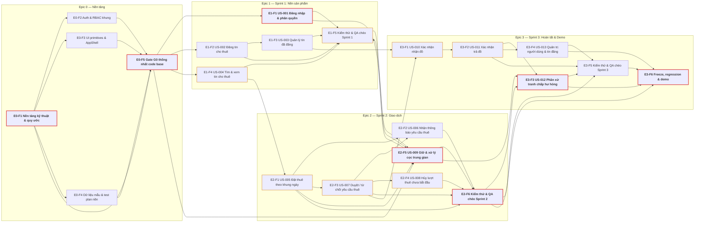

> **SUPERSEDED (mức Sprint)** — Cấu trúc sprint-level đã được tái cấu trúc theo phản hồi giảng viên. Xem `gearloop_agile_sprint_plan.md` (phiên bản 2.0). **Dữ liệu task-level (§3–§5, 98 task, CPM, đường găng) trong file này vẫn là nguồn đúng.**

# GearLoop — Kế hoạch dự án Agile chi tiết (6 tuần · 28/10 → 08/12/2026)

> **Phiên bản 1.0 — lập ngày 28/10/2026.** Nguồn: `gearloop_user_stories.md` (13 story nền US-001…US-013, 10 Must / 3 Should), `gearloop_user_story_specs.md` (AC + BR, Phụ lục D Q1–Q12), `gearloop_architecture_blueprint.md` (§3/§6/§7/§11), `wb4_gearloop/` (E-R1…E-R9). Deadline cứng: **08/12/2026**; làm việc liên tục theo tuần, **không trừ ngày lễ**.

## 1. Nguyên tắc & thông tin nền

### 1.1 Mục tiêu & phạm vi
- Hoàn thành sản phẩm GearLoop (CRUD MVP) đủ **13 user story nền** với hạ tầng chất lượng (CI, test tự động, seed, walking skeleton) và **demo cuối + nộp báo cáo 08/12/2026**.
- Task được bóc từ **mục 4–5 của từng story** (Acceptance Criteria + Business Rules) trong `gearloop_user_story_specs.md`; **không bóc từ mục Out of Scope**. US-W1…US-W9 (watchlist) ngoài phạm vi kế hoạch này.
- Một repo — một code base duy nhất: **Gate G0 “thống nhất code base” (03/11) phải sign-off trước khi chia việc theo user story**, để 8 người không mỗi người dựng một nền riêng.

### 1.2 Lịch & sprint
- 6 tuần liên tục: Tuần 1 (28/10–03/11) · Tuần 2 (04–10/11) · Tuần 3 (11–17/11) · Tuần 4 (18–24/11) · Tuần 5 (25/11–01/12) · Tuần 6 (02–08/12).
- Cấu trúc sprint: **3 sprint** (nhãn trùng khớp backlog nguồn) — **S1** = tuần 2–3 (2 tuần) · **S2** = tuần 4–5 (2 tuần) · **S3** = tuần 6 (1 tuần, gồm freeze/rehearsal/demo) — cộng **Sprint 0** khởi tạo = tuần 1 (nền tảng, gate G0). S3 rút ngắn vì mốc demo 08/12 cố định; giữa các sprint áp dụng fast-tracking (A11) nên story sprint sau khởi động trước khi sprint trước khép lại.
- Nhãn Sprint nguồn của story (Sprint 1/2/3) giữ nguyên trong từng feature tương ứng (Epic 1 = Sprint 1 · Epic 2 = Sprint 2 · Epic 3 = Sprint 3). **[ASSUMPTION] Điều chỉnh lịch:** US-005 khởi động 10/11, US-010 khởi động 18/11, US-013 từ 01/12 — kéo sớm có chủ đích để bảo toàn chuỗi phụ thuộc 005→007→010→011→012 trước freeze 05/12; xác nhận tại review Sprint 1.
- Mốc: **G0 03/11** · S1 review 17/11 · S2 review 01/12 · **freeze 05/12** · regression 06/12 · rehearsal 07/12 · **demo + nộp 08/12**.

### 1.3 Tổ chức nhân sự (4 cặp cố định theo feature)
| Cặp | Thành viên | Vai trò chính | Feature phụ trách |
|---|---|---|---|
| P1 | Nguyễn Hồng Đức + Lê Anh Dũng | Platform / CI-CD / Notification / Release-Demo | Epic 0-F1, Epic 0-F5, US-006, kiểm thử & release/demo |
| P2 | Nguyễn Quốc Bảo + Trần Nguyên Hoàng | Item-Listing / điều kiện bàn giao–hoàn trả / Admin | Epic 0-F3, US-002, US-003, US-010, US-011, US-013 |
| P3 | Vũ Đức Hiếu + Nguyễn Quốc Anh | Search & Booking flow | Epic 0-F4, US-004, US-005, US-007, US-008, QA chéo |
| P4 | Trần Tiến Đạt + Phạm Trung Anh | Auth/RBAC / Deposit ledger / Dispute | Epic 0-F2, US-001, US-009, US-012, QA chéo |

- **Epic 0 do cặp P1 chủ trì (2 người phụ trách hạ tầng)**; ba cặp còn lại đóng góp hạng mục chuyên môn trong Tuần 1 (UI primitives — P2; seed/test plan — P3; Auth/RBAC khung + khung test — P4) và mọi hạng mục phải qua review của P1 trước Gate G0.
- **QA chéo bắt buộc**: mỗi feature được kiểm thử bởi một cặp khác trước review sprint (các task “QA chéo …” ghi rõ cặp thực hiện).
- Mỗi cặp là **một đơn vị thực thi tuần tự** (không làm 2 task song song) — đây là ràng buộc nguồn lực dùng khi tính mạng lưới ở §5.

### 1.4 Quy ước ước lượng, AT RISK, trạng thái
- **Story point Fibonacci 1/2/3/5**; mỗi task ≤ 2 ngày; 1 ngày ≈ 2 SP, 2 ngày ≈ 2–5 SP tùy độ phức tạp/rủi ro. **[ASSUMPTION]** 1 SP ≈ 0,5 ngày công cặp.
- **[ASSUMPTION] Capacity ~40 SP/sprint/tuần cho 8 người** (≈ 5 SP/người/tuần) → 6 tuần = **240 SP**; kế hoạch dùng **217 SP** (buffer ~9%).
- **AT RISK = Yes** nếu: (a) task phụ thuộc tham số chưa chốt tại **Phụ lục D, Q1–Q12** (COMMENTS ghi rõ Qx); hoặc (b) task **thuộc đường găng / Slack = 0** (§5).
- **STATUS = “Not Started”** cho toàn bộ kế hoạch (mới lập); cập nhật theo thực tế tại mỗi review.
- Ghi chú thiếu thông tin: dùng `—`; các suy luận của người lập kế hoạch gắn nhãn `[ASSUMPTION]`.

### 1.5 DoR / DoD ngắn
- **DoR (điều kiện bắt đầu):** task có AC + rule nguồn, không còn câu hỏi chặn (đã xử lý theo mục 7), UI dùng primitives chung, schema đã ở Gate G0.
- **DoD (điều kiện xong):** AC liên quan pass (unit/e2e), review ≥ 1 (cặp khác), CI xanh, không phá vỡ contract chung (error catalog/response envelope), QA chéo ghi nhận lỗi đã xử lý.

## 2. Cấu trúc WBS 3 tầng (Epic → Feature → Task) & phân bổ

- Tầng **L1 — Epic** (4), **L2 — Feature** (22), **L3 — Task** (98 task ≤ 2 ngày). Mã WBS: `E<epic>-F<feature>-T<n>`.
- Bảng dưới đây liệt kê L1–L2 (cột “Ghi chú” ghi SP/AC-BR roll-up; L3 đầy đủ ở §3 với cột `Level = L3 — Task`).
- Nhãn Sprint nguồn: Epic 1 = Sprint 1 (US-001…004) · Epic 2 = Sprint 2 (US-005…009) · Epic 3 = Sprint 3 (US-010…013). Epic 0 = Sprint 0 (nền tảng).

| AT RISK | Cấp | Mã (WBS) | Tên | Loại | Cặp phụ trách | SP | Bắt đầu | Kết thúc | Ngày | Trạng thái | Ghi chú |
|---|---|---|---|---|---|---:|---|---|---:|---|---|
| Yes | L1 — Epic | E0 | Epic 0 — Nền tảng / Walking Skeleton (gate G0 03/11) | — | Nguyễn Hồng Đức + Lê Anh Dũng (chủ trì) | 35 | 28/10 | 03/11 | 7 | Not Started | 5 feature · 15 task · 35 SP |
| Yes | L2 — Feature | E0-F1 | Nền tảng kỹ thuật & quy ước | Foundation | Nguyễn Hồng Đức + Lê Anh Dũng | 13 | 28/10 | 02/11 | 6 | Not Started | 5 task · 13 SP |
| Yes | L2 — Feature | E0-F2 | Auth & RBAC khung | Auth/RBAC | Trần Tiến Đạt + Phạm Trung Anh | 7 | 29/10 | 02/11 | 5 | Not Started | 3 task · 7 SP |
| Yes | L2 — Feature | E0-F3 | UI primitives & AppShell | Foundation | Nguyễn Quốc Bảo + Trần Nguyên Hoàng | 7 | 30/10 | 02/11 | 4 | Not Started | 3 task · 7 SP |
| Yes | L2 — Feature | E0-F4 | Dữ liệu mẫu & test plan nền | Testing | Vũ Đức Hiếu + Nguyễn Quốc Anh | 6 | 29/10 | 02/11 | 5 | Not Started | 3 task · 6 SP |
| Yes | L2 — Feature | E0-F5 | Gate G0 — “thống nhất code base” | Foundation | Toàn nhóm (Đức + Dũng chủ trì) | 2 | 03/11 | 03/11 | 1 | Not Started | 1 task · 2 SP |
| Yes | L1 — Epic | E1 | Epic 1 — Sprint 1: Nền sản phẩm (US-001→US-004) | — | Toàn nhóm | 51 | 04/11 | 17/11 | 14 | Not Started | 5 feature · 26 task · 51 SP |
| Yes | L2 — Feature | E1-F1 | US-001 Đăng nhập & phân quyền | Auth/RBAC | Trần Tiến Đạt + Phạm Trung Anh | 9 | 04/11 | 09/11 | 6 | Not Started | 4 task · 9 SP · AC 6/BR 5 |
| Yes | L2 — Feature | E1-F2 | US-002 Đăng tin cho thuê | Item | Nguyễn Quốc Bảo + Trần Nguyên Hoàng | 10 | 04/11 | 10/11 | 7 | Not Started | 5 task · 10 SP · AC 8/BR 4 |
| Yes | L2 — Feature | E1-F3 | US-003 Quản lý tin đã đăng | Item | Nguyễn Quốc Bảo + Trần Nguyên Hoàng | 8 | 11/11 | 14/11 | 4 | Not Started | 3 task · 8 SP · AC 8/BR 4 |
| Yes | L2 — Feature | E1-F4 | US-004 Tìm & xem tin cho thuê | Search | Vũ Đức Hiếu + Nguyễn Quốc Anh | 8 | 04/11 | 09/11 | 6 | Not Started | 4 task · 8 SP · AC 7/BR 4 |
| Yes | L2 — Feature | E1-F5 | Kiểm thử & QA chéo Sprint 1 | Testing | Nguyễn Hồng Đức + Lê Anh Dũng | 16 | 04/11 | 17/11 | 14 | Not Started | 10 task · 16 SP |
| Yes | L1 — Epic | E2 | Epic 2 — Sprint 2: Giao dịch (US-005→US-009) | — | Toàn nhóm | 69 | 10/11 | 01/12 | 22 | Not Started | 6 feature · 31 task · 69 SP |
| Yes | L2 — Feature | E2-F1 | US-005 Đặt thuê theo khung ngày | Booking | Vũ Đức Hiếu + Nguyễn Quốc Anh | 13 | 10/11 | 17/11 | 8 | Not Started | 5 task · 13 SP · AC 10/BR 6 |
| Yes | L2 — Feature | E2-F2 | US-006 Nhận thông báo yêu cầu thuê | Notification | Nguyễn Hồng Đức + Lê Anh Dũng | 9 | 18/11 | 25/11 | 8 | Not Started | 4 task · 9 SP · AC 3/BR 3 |
| Yes | L2 — Feature | E2-F3 | US-007 Duyệt / từ chối yêu cầu thuê | Booking | Vũ Đức Hiếu + Nguyễn Quốc Anh | 11 | 18/11 | 22/11 | 5 | Not Started | 4 task · 11 SP · AC 7/BR 5 |
| Yes | L2 — Feature | E2-F4 | US-008 Hủy lượt thuê chưa bắt đầu | Booking | Vũ Đức Hiếu + Nguyễn Quốc Anh | 7 | 23/11 | 26/11 | 4 | Not Started | 4 task · 7 SP · AC 7/BR 4 |
| Yes | L2 — Feature | E2-F5 | US-009 Giữ & xử lý cọc trung gian | Deposit | Trần Tiến Đạt + Phạm Trung Anh | 17 | 10/11 | 25/11 | 16 | Not Started | 7 task · 17 SP · AC 11/BR 10 |
| Yes | L2 — Feature | E2-F6 | Kiểm thử & QA chéo Sprint 2 | Testing | Nguyễn Hồng Đức + Lê Anh Dũng | 12 | 26/11 | 01/12 | 6 | Not Started | 7 task · 12 SP |
| Yes | L1 — Epic | E3 | Epic 3 — Sprint 3: Hoàn tất & Demo (US-010→US-013 + freeze/rehearsal) | — | Toàn nhóm | 62 | 18/11 | 08/12 | 21 | Not Started | 6 feature · 26 task · 62 SP |
| Yes | L2 — Feature | E3-F1 | US-010 Xác nhận nhận đồ | Booking | Nguyễn Quốc Bảo + Trần Nguyên Hoàng | 9 | 18/11 | 25/11 | 8 | Not Started | 4 task · 9 SP · AC 6/BR 4 |
| Yes | L2 — Feature | E3-F2 | US-011 Xác nhận trả đồ | Booking | Nguyễn Quốc Bảo + Trần Nguyên Hoàng | 9 | 26/11 | 30/11 | 5 | Not Started | 3 task · 9 SP · AC 6/BR 5 |
| Yes | L2 — Feature | E3-F3 | US-012 Phân xử tranh chấp hư hỏng | Dispute | Trần Tiến Đạt + Phạm Trung Anh | 14 | 27/11 | 04/12 | 8 | Not Started | 5 task · 14 SP · AC 8/BR 8 |
| Yes | L2 — Feature | E3-F4 | US-013 Quản trị người dùng & tin đăng | Admin | Nguyễn Quốc Bảo + Trần Nguyên Hoàng | 7 | 01/12 | 03/12 | 3 | Not Started | 3 task · 7 SP · AC 8/BR 6 |
| Yes | L2 — Feature | E3-F5 | Kiểm thử & QA chéo Sprint 3 | Testing | Chéo cặp (P3 · P1 · P2 · P4) | 9 | 01/12 | 05/12 | 5 | Not Started | 5 task · 9 SP |
| Yes | L2 — Feature | E3-F6 | Freeze, regression & demo | Demo | Nguyễn Hồng Đức + Lê Anh Dũng | 14 | 02/12 | 08/12 | 7 | Not Started | 6 task · 14 SP |

**Tổng: 4 epic · 22 feature · 98 task · 217 SP** (mọi task L3 ≤ 2 ngày; xem §3 để tra từng task).

## 3. Bảng Agile Project Plan

**Đúng bộ cột yêu cầu.** Dòng `L1 — Epic` / `L2 — Feature` là dòng tổng hợp (SP roll-up, START/FINISH là khoảng bao của các task con). Dòng `L3 — Task` là đơn vị thực thi ≤ 2 ngày. `COMMENTS` ghi nguồn AC/BR của story, ghi chú kỹ thuật và lý do AT RISK (Qx = câu hỏi chưa chốt tại Phụ lục D — `gearloop_user_story_specs.md`; “Trên đường găng” = Slack 0 tại §5).

| AT RISK | Level | Task ID (WBS) | TASK NAME | FEATURE TYPE | RESPONSIBLE | STORY POINTS | START | FINISH | DURATION (DAYS) | STATUS | COMMENTS |
|---|---|---|---|---|---|---:|---|---|---:|---|---|
| Yes | L1 — Epic | E0 | Epic 0 — Nền tảng / Walking Skeleton (gate G0 03/11) | — | Nguyễn Hồng Đức + Lê Anh Dũng (chủ trì) | 35 | 28/10 | 03/11 | 7 | Not Started | 5 feature · 15 task · 35 SP |
| Yes | L2 — Feature | E0-F1 | Nền tảng kỹ thuật & quy ước | Foundation | Nguyễn Hồng Đức + Lê Anh Dũng | 13 | 28/10 | 02/11 | 6 | Not Started | 5 task · 13 SP |
| Yes | L3 — Task | E0-F1-T1 | Khởi tạo repo GitHub + monorepo + quy ước branch/PR + AGENTS.md/CONTRIBUTING | Foundation | Nguyễn Hồng Đức + Lê Anh Dũng | 2 | 28/10 | 28/10 | 1 | Not Started | Quy ước commit/PR, CODEOWNERS; Trên đường găng (Slack=0) |
| Yes | L3 — Task | E0-F1-T2 | Docker Compose Postgres + .env.example + script `make dev` | Foundation | Nguyễn Hồng Đức + Lê Anh Dũng | 2 | 29/10 | 29/10 | 1 | Not Started | Trên đường găng (Slack=0) |
| Yes | L3 — Task | E0-F1-T3 | Prisma multi-file schema 8 model + luồng migrate | Foundation | Nguyễn Hồng Đức + Lê Anh Dũng | 5 | 30/10 | 31/10 | 2 | Not Started | User/Item/Availability/Booking/DepositTransaction/ConditionReport/Dispute/NotificationLog; Trên đường găng (Slack=0) |
| Yes | L3 — Task | E0-F1-T4 | CI gate (lint + typecheck + test + build) chặn merge lỗi | Foundation | Nguyễn Hồng Đức + Lê Anh Dũng | 2 | 01/11 | 01/11 | 1 | Not Started | Trên đường găng (Slack=0) |
| Yes | L3 — Task | E0-F1-T5 | Error catalog chung + Zod schema + response envelope | Foundation | Nguyễn Hồng Đức + Lê Anh Dũng | 2 | 02/11 | 02/11 | 1 | Not Started | ERR-USR/ERR-SYS + NTF contract; Trên đường găng (Slack=0) |
| Yes | L2 — Feature | E0-F2 | Auth & RBAC khung | Auth/RBAC | Trần Tiến Đạt + Phạm Trung Anh | 7 | 29/10 | 02/11 | 5 | Not Started | 3 task · 7 SP |
| Yes | L3 — Task | E0-F2-T1 | Khung test tự động (Vitest + Playwright) + smoke test trong CI | Testing | Trần Tiến Đạt + Phạm Trung Anh | 2 | 29/10 | 30/10 | 2 | Not Started | Trên đường găng (Slack=0) |
| Yes | L3 — Task | E0-F2-T2 | Auth.js + session + trang đăng nhập/đăng xuất khung | Auth/RBAC | Trần Tiến Đạt + Phạm Trung Anh | 3 | 31/10 | 01/11 | 2 | Not Started | Tích hợp schema E0-F1-T3 sau migrate; Trên đường găng (Slack=0) |
| Yes | L3 — Task | E0-F2-T3 | RBAC guard base + ma trận quyền theo vai (khung) | Auth/RBAC | Trần Tiến Đạt + Phạm Trung Anh | 2 | 02/11 | 02/11 | 1 | Not Started | Trên đường găng (Slack=0) |
| Yes | L2 — Feature | E0-F3 | UI primitives & AppShell | Foundation | Nguyễn Quốc Bảo + Trần Nguyên Hoàng | 7 | 30/10 | 02/11 | 4 | Not Started | 3 task · 7 SP |
| Yes | L3 — Task | E0-F3-T1 | Design tokens + theme + AppShell điều hướng theo vai | Foundation | Nguyễn Quốc Bảo + Trần Nguyên Hoàng | 2 | 30/10 | 30/10 | 1 | Not Started | Trên đường găng (Slack=0) |
| Yes | L3 — Task | E0-F3-T2 | UI primitives: Button/Input/Select/Table/Card/Toast/EmptyState | Foundation | Nguyễn Quốc Bảo + Trần Nguyên Hoàng | 3 | 31/10 | 31/10 | 1 | Not Started | Trên đường găng (Slack=0) |
| Yes | L3 — Task | E0-F3-T3 | Trang chủ skeleton + trang lỗi 4xx/5xx + loading/empty state | Foundation | Nguyễn Quốc Bảo + Trần Nguyên Hoàng | 2 | 01/11 | 02/11 | 2 | Not Started | Trên đường găng (Slack=0) |
| Yes | L2 — Feature | E0-F4 | Dữ liệu mẫu & test plan nền | Testing | Vũ Đức Hiếu + Nguyễn Quốc Anh | 6 | 29/10 | 02/11 | 5 | Not Started | 3 task · 6 SP |
| No | L3 — Task | E0-F4-T1 | Rà soát spec + lập test plan v0 cho Sprint 1 | Testing | Vũ Đức Hiếu + Nguyễn Quốc Anh | 2 | 29/10 | 30/10 | 2 | Not Started | — |
| Yes | L3 — Task | E0-F4-T2 | Review chéo schema + ADR quy ước DB/API | Testing | Vũ Đức Hiếu + Nguyễn Quốc Anh | 2 | 01/11 | 01/11 | 1 | Not Started | Trên đường găng (Slack=0) |
| Yes | L3 — Task | E0-F4-T3 | Seed data v1 (3 vai + 8 tin mẫu + khung rảnh) + script reset DB | Testing | Vũ Đức Hiếu + Nguyễn Quốc Anh | 2 | 02/11 | 02/11 | 1 | Not Started | Trên đường găng (Slack=0) |
| Yes | L2 — Feature | E0-F5 | Gate G0 — “thống nhất code base” | Foundation | Toàn nhóm (Đức + Dũng chủ trì) | 2 | 03/11 | 03/11 | 1 | Not Started | 1 task · 2 SP |
| Yes | L3 — Task | E0-F5-T1 | Checklist + review chéo + sign-off Gate G0 “code base thống nhất” | Foundation | Toàn nhóm (Đức + Dũng chủ trì) | 2 | 03/11 | 03/11 | 1 | Not Started | Chưa sign-off thì chưa chia việc theo US; Trên đường găng (Slack=0) |
| Yes | L1 — Epic | E1 | Epic 1 — Sprint 1: Nền sản phẩm (US-001→US-004) | — | Toàn nhóm | 51 | 04/11 | 17/11 | 14 | Not Started | 5 feature · 26 task · 51 SP |
| Yes | L2 — Feature | E1-F1 | US-001 Đăng nhập & phân quyền | Auth/RBAC | Trần Tiến Đạt + Phạm Trung Anh | 9 | 04/11 | 09/11 | 6 | Not Started | 4 task · 9 SP · AC 6/BR 5 |
| Yes | L3 — Task | E1-F1-T1 | Hoàn thiện đăng nhập/đăng xuất + quản lý phiên + thông báo lỗi xác thực | Auth/RBAC | Trần Tiến Đạt + Phạm Trung Anh | 3 | 04/11 | 05/11 | 2 | Not Started | AC-001-01..03; BR-001-01..03; Chờ chốt Q12 (Phụ lục D); Trên đường găng (Slack=0) |
| Yes | L3 — Task | E1-F1-T2 | Tài khoản mẫu 3 vai + gán vai theo phiên + chặn đăng nhập tài khoản khóa | Auth/RBAC | Trần Tiến Đạt + Phạm Trung Anh | 2 | 06/11 | 07/11 | 2 | Not Started | AC-001-01, 04; BR-001-01, 04; Trên đường găng (Slack=0) |
| Yes | L3 — Task | E1-F1-T3 | Áp ma trận RBAC lên toàn bộ route + chặn thao tác trái vai | Auth/RBAC | Trần Tiến Đạt + Phạm Trung Anh | 2 | 08/11 | 08/11 | 1 | Not Started | AC-001-06; BR-001-01; Trên đường găng (Slack=0) |
| Yes | L3 — Task | E1-F1-T4 | Thu hồi quyền khi phiên hết hạn + kiểm thử US-001 (unit + e2e) | Auth/RBAC | Trần Tiến Đạt + Phạm Trung Anh | 2 | 09/11 | 09/11 | 1 | Not Started | AC-001-05; Chờ chốt Q12 (Phụ lục D); Trên đường găng (Slack=0) |
| Yes | L2 — Feature | E1-F2 | US-002 Đăng tin cho thuê | Item | Nguyễn Quốc Bảo + Trần Nguyên Hoàng | 10 | 04/11 | 10/11 | 7 | Not Started | 5 task · 10 SP · AC 8/BR 4 |
| Yes | L3 — Task | E1-F2-T1 | Form đăng tin: mô tả, tình trạng, giá thuê, mức cọc + validation bắt buộc | Item | Nguyễn Quốc Bảo + Trần Nguyên Hoàng | 2 | 04/11 | 05/11 | 2 | Not Started | AC-002-01..04; BR-002-01/02; Chờ chốt Q1 (Phụ lục D) |
| Yes | L3 — Task | E1-F2-T2 | Khung ngày giờ rảnh: nhập nhiều khung + chặn tự chồng lấn | Item | Nguyễn Quốc Bảo + Trần Nguyên Hoàng | 3 | 06/11 | 07/11 | 2 | Not Started | AC-002-05..07; BR-002-03; Chờ chốt Q11 (Phụ lục D) |
| Yes | L3 — Task | E1-F2-T3 | Tải ảnh tin đăng: bắt buộc ≥1 ảnh + định dạng/dung lượng | Item | Nguyễn Quốc Bảo + Trần Nguyên Hoàng | 2 | 08/11 | 08/11 | 1 | Not Started | AC-002-01/02; Chờ chốt Q7 (Phụ lục D) |
| No | L3 — Task | E1-F2-T4 | Danh sách tin của tôi + trạng thái tin + xuất bản tin | Item | Nguyễn Quốc Bảo + Trần Nguyên Hoàng | 2 | 09/11 | 09/11 | 1 | Not Started | AC-002-01 |
| No | L3 — Task | E1-F2-T5 | Kiểm thử + sửa lỗi US-002 | Item | Nguyễn Quốc Bảo + Trần Nguyên Hoàng | 1 | 10/11 | 10/11 | 1 | Not Started | — |
| Yes | L2 — Feature | E1-F3 | US-003 Quản lý tin đã đăng | Item | Nguyễn Quốc Bảo + Trần Nguyên Hoàng | 8 | 11/11 | 14/11 | 4 | Not Started | 3 task · 8 SP · AC 8/BR 4 |
| Yes | L3 — Task | E1-F3-T1 | Sửa tin đã đăng + bảo toàn snapshot booking đã tạo | Item | Nguyễn Quốc Bảo + Trần Nguyên Hoàng | 3 | 11/11 | 12/11 | 2 | Not Started | AC-003-02/03; BR-003-02; Chờ chốt Q11 (Phụ lục D) |
| No | L3 — Task | E1-F3-T2 | Tạm ẩn/mở lại tin + chặn khi có booking CONFIRMED/PICKED_UP | Item | Nguyễn Quốc Bảo + Trần Nguyên Hoàng | 3 | 13/11 | 13/11 | 1 | Not Started | AC-003-04..06; BR-003-04 |
| No | L3 — Task | E1-F3-T3 | Quản lý ảnh tin + kiểm thử US-003 | Item | Nguyễn Quốc Bảo + Trần Nguyên Hoàng | 2 | 14/11 | 14/11 | 1 | Not Started | AC-003-07/08 |
| Yes | L2 — Feature | E1-F4 | US-004 Tìm & xem tin cho thuê | Search | Vũ Đức Hiếu + Nguyễn Quốc Anh | 8 | 04/11 | 09/11 | 6 | Not Started | 4 task · 8 SP · AC 7/BR 4 |
| Yes | L3 — Task | E1-F4-T1 | Danh sách tin công khai (chỉ OPEN) + phân trang | Search | Vũ Đức Hiếu + Nguyễn Quốc Anh | 2 | 04/11 | 05/11 | 2 | Not Started | AC-004-01; BR-004-01; Chờ chốt Q8 (Phụ lục D); Trên đường găng (Slack=0) |
| Yes | L3 — Task | E1-F4-T2 | Tìm theo từ khóa + lọc theo khoảng ngày còn trống | Search | Vũ Đức Hiếu + Nguyễn Quốc Anh | 3 | 06/11 | 07/11 | 2 | Not Started | AC-004-02/03; BR-004-02; Chờ chốt Q2 (Phụ lục D); Trên đường găng (Slack=0) |
| Yes | L3 — Task | E1-F4-T3 | Chi tiết tin: giá, cọc, khung rảnh, điểm bàn giao | Search | Vũ Đức Hiếu + Nguyễn Quốc Anh | 2 | 08/11 | 08/11 | 1 | Not Started | AC-004-04; BR-004-03; Trên đường găng (Slack=0) |
| Yes | L3 — Task | E1-F4-T4 | Chặn hiển thị tin bị ẩn/chủ bị khóa + kiểm thử US-004 | Search | Vũ Đức Hiếu + Nguyễn Quốc Anh | 1 | 09/11 | 09/11 | 1 | Not Started | AC-004-05..07; BR-004-04; Chờ chốt Q9 (Phụ lục D); Trên đường găng (Slack=0) |
| Yes | L2 — Feature | E1-F5 | Kiểm thử & QA chéo Sprint 1 | Testing | Nguyễn Hồng Đức + Lê Anh Dũng | 16 | 04/11 | 17/11 | 14 | Not Started | 10 task · 16 SP |
| No | L3 — Task | E1-F5-T1 | Nâng cấp CI: coverage report + quality gate + preview deploy | Testing | Nguyễn Hồng Đức + Lê Anh Dũng | 2 | 04/11 | 05/11 | 2 | Not Started | — |
| No | L3 — Task | E1-F5-T2 | Contract test API + test fixtures dùng chung | Testing | Nguyễn Hồng Đức + Lê Anh Dũng | 2 | 06/11 | 07/11 | 2 | Not Started | — |
| No | L3 — Task | E1-F5-T3 | Hỗ trợ tích hợp S1 + rà soát PR + xử lý nợ kỹ thuật nền tảng | Testing | Nguyễn Hồng Đức + Lê Anh Dũng | 2 | 08/11 | 09/11 | 2 | Not Started | — |
| No | L3 — Task | E1-F5-T4 | Chốt test plan chi tiết S1 + cập nhật quality gate | Testing | Nguyễn Hồng Đức + Lê Anh Dũng | 1 | 10/11 | 10/11 | 1 | Not Started | — |
| No | L3 — Task | E1-F5-T5 | Tự động hoá e2e luồng S1 (đăng nhập → đăng tin → tìm kiếm) | Testing | Nguyễn Hồng Đức + Lê Anh Dũng | 2 | 11/11 | 12/11 | 2 | Not Started | — |
| No | L3 — Task | E1-F5-T6 | QA chéo US-004 (P1 thực hiện) + báo lỗi | Testing | Nguyễn Hồng Đức + Lê Anh Dũng | 1 | 13/11 | 14/11 | 2 | Not Started | Chủ sở hữu US-004: P3 |
| Yes | L3 — Task | E1-F5-T8 | QA chéo US-002 (P4 thực hiện) + báo lỗi | Testing | Trần Tiến Đạt + Phạm Trung Anh | 1 | 14/11 | 15/11 | 2 | Not Started | Trên đường găng (Slack=0) |
| No | L3 — Task | E1-F5-T7 | QA chéo US-003 (P1 thực hiện) + hồi quy S1 | Testing | Nguyễn Hồng Đức + Lê Anh Dũng | 2 | 15/11 | 16/11 | 2 | Not Started | Chủ sở hữu US-003: P2 |
| No | L3 — Task | E1-F5-T9 | QA chéo US-001 (P2 thực hiện) + báo lỗi | Testing | Nguyễn Quốc Bảo + Trần Nguyên Hoàng | 1 | 16/11 | 16/11 | 1 | Not Started | — |
| No | L3 — Task | E1-F5-T10 | Sprint 1 review + demo nội bộ (mốc 17/11) | Demo | Toàn nhóm (Đức + Dũng chủ trì) | 2 | 17/11 | 17/11 | 1 | Not Started | — |
| Yes | L1 — Epic | E2 | Epic 2 — Sprint 2: Giao dịch (US-005→US-009) | — | Toàn nhóm | 69 | 10/11 | 01/12 | 22 | Not Started | 6 feature · 31 task · 69 SP |
| Yes | L2 — Feature | E2-F1 | US-005 Đặt thuê theo khung ngày | Booking | Vũ Đức Hiếu + Nguyễn Quốc Anh | 13 | 10/11 | 17/11 | 8 | Not Started | 5 task · 13 SP · AC 10/BR 6 |
| Yes | L3 — Task | E2-F1-T1 | Validate đầu vào đặt thuê: ngày quá khứ, ngày kết thúc ≤ bắt đầu, tin ẩn/khóa, tự đặt | Booking | Vũ Đức Hiếu + Nguyễn Quốc Anh | 3 | 10/11 | 11/11 | 2 | Not Started | AC-005-03..06; BR-005-06; Chờ chốt Q11 (Phụ lục D); Trên đường găng (Slack=0) |
| Yes | L3 — Task | E2-F1-T2 | Chặn trùng lịch + xử lý hai người đặt đồng thời (giao dịch tuần tự) | Booking | Vũ Đức Hiếu + Nguyễn Quốc Anh | 3 | 12/11 | 13/11 | 2 | Not Started | AC-005-02/07; BR-005-01; Chờ chốt Q2 (Phụ lục D); Trên đường găng (Slack=0) |
| Yes | L3 — Task | E2-F1-T3 | Snapshot giá/cọc/điểm bàn giao khi tạo booking | Booking | Vũ Đức Hiếu + Nguyễn Quốc Anh | 3 | 14/11 | 14/11 | 1 | Not Started | AC-005-01/08; BR-005-02; HOLD → E2-F5-T3 (P4); Chờ chốt Q1 (Phụ lục D); Trên đường găng (Slack=0) |
| Yes | L3 — Task | E2-F1-T4 | Luồng UI đặt thuê: chọn ngày, điểm bàn giao, xác nhận | Booking | Vũ Đức Hiếu + Nguyễn Quốc Anh | 2 | 15/11 | 16/11 | 2 | Not Started | AC-005-10; BR-005-05; Chờ chốt Q11 (Phụ lục D); Trên đường găng (Slack=0) |
| Yes | L3 — Task | E2-F1-T5 | Kiểm thử US-005 (race, validate) + sửa lỗi | Booking | Vũ Đức Hiếu + Nguyễn Quốc Anh | 2 | 17/11 | 17/11 | 1 | Not Started | Trên đường găng (Slack=0) |
| Yes | L2 — Feature | E2-F2 | US-006 Nhận thông báo yêu cầu thuê | Notification | Nguyễn Hồng Đức + Lê Anh Dũng | 9 | 18/11 | 25/11 | 8 | Not Started | 4 task · 9 SP · AC 3/BR 3 |
| Yes | L3 — Task | E2-F2-T1 | Phát NTF-001 khi có yêu cầu thuê mới + danh sách thông báo | Notification | Nguyễn Hồng Đức + Lê Anh Dũng | 3 | 18/11 | 19/11 | 2 | Not Started | AC-006-01/02; BR-006-01; Chờ chốt Q8 (Phụ lục D) |
| Yes | L3 — Task | E2-F2-T2 | Trung tâm thông báo: trạng thái đã đọc + điều hướng tới booking | Notification | Nguyễn Hồng Đức + Lê Anh Dũng | 2 | 20/11 | 20/11 | 1 | Not Started | AC-006-02/03; BR-006-02; Chờ chốt Q8 (Phụ lục D) |
| Yes | L3 — Task | E2-F2-T3 | Thông báo sự kiện duyệt/từ chối/hủy + template | Notification | Nguyễn Hồng Đức + Lê Anh Dũng | 3 | 23/11 | 24/11 | 2 | Not Started | NTF-002/003/006; Trên đường găng (Slack=0) |
| Yes | L3 — Task | E2-F2-T4 | Kiểm thử US-006 + sửa lỗi | Notification | Nguyễn Hồng Đức + Lê Anh Dũng | 1 | 25/11 | 25/11 | 1 | Not Started | Trên đường găng (Slack=0) |
| Yes | L2 — Feature | E2-F3 | US-007 Duyệt / từ chối yêu cầu thuê | Booking | Vũ Đức Hiếu + Nguyễn Quốc Anh | 11 | 18/11 | 22/11 | 5 | Not Started | 4 task · 11 SP · AC 7/BR 5 |
| Yes | L3 — Task | E2-F3-T1 | Duyệt yêu cầu: REQUESTED→CONFIRMED + kiểm tra lại trùng lịch khi duyệt | Booking | Vũ Đức Hiếu + Nguyễn Quốc Anh | 5 | 18/11 | 19/11 | 2 | Not Started | AC-007-01/03/05; BR-007-01/04; Trên đường găng (Slack=0) |
| Yes | L3 — Task | E2-F3-T2 | Từ chối yêu cầu: CANCELLED + hoàn cọc RELEASE | Booking | Vũ Đức Hiếu + Nguyễn Quốc Anh | 2 | 20/11 | 20/11 | 1 | Not Started | AC-007-02; BR-007-02; Trên đường găng (Slack=0) |
| Yes | L3 — Task | E2-F3-T3 | Hết hạn 24h chờ duyệt: EXPIRED + hoàn cọc + mở lịch | Booking | Vũ Đức Hiếu + Nguyễn Quốc Anh | 2 | 21/11 | 21/11 | 1 | Not Started | AC-007-04; BR-007-03/009-04 — ĐỀ XUẤT; Chờ chốt Q3 (Phụ lục D); Trên đường găng (Slack=0) |
| Yes | L3 — Task | E2-F3-T4 | Kiểm thử US-007 (quyền, race, hết hạn) + sửa lỗi | Booking | Vũ Đức Hiếu + Nguyễn Quốc Anh | 2 | 22/11 | 22/11 | 1 | Not Started | Trên đường găng (Slack=0) |
| Yes | L2 — Feature | E2-F4 | US-008 Hủy lượt thuê chưa bắt đầu | Booking | Vũ Đức Hiếu + Nguyễn Quốc Anh | 7 | 23/11 | 26/11 | 4 | Not Started | 4 task · 7 SP · AC 7/BR 4 |
| Yes | L3 — Task | E2-F4-T1 | Renter hủy REQUESTED: giải phóng lịch + hoàn cọc | Booking | Vũ Đức Hiếu + Nguyễn Quốc Anh | 2 | 23/11 | 23/11 | 1 | Not Started | AC-008-01; BR-008-01; Trên đường găng (Slack=0) |
| Yes | L3 — Task | E2-F4-T2 | Renter hủy CONFIRMED: chính sách hoàn tiền theo mốc 48h | Booking | Vũ Đức Hiếu + Nguyễn Quốc Anh | 2 | 24/11 | 24/11 | 1 | Not Started | AC-008-02/03; BR-008-02 — ĐỀ XUẤT; Chờ chốt Q5 (Phụ lục D); Trên đường găng (Slack=0) |
| Yes | L3 — Task | E2-F4-T3 | Owner hủy lượt đã xác nhận: hoàn 100% + voucher + strike | Booking | Vũ Đức Hiếu + Nguyễn Quốc Anh | 2 | 25/11 | 25/11 | 1 | Not Started | AC-008-06/07; E-R5; Chờ chốt Q6 (Phụ lục D); Trên đường găng (Slack=0) |
| Yes | L3 — Task | E2-F4-T4 | Kiểm thử US-008 + sửa lỗi | Booking | Vũ Đức Hiếu + Nguyễn Quốc Anh | 1 | 26/11 | 26/11 | 1 | Not Started | Trên đường găng (Slack=0) |
| Yes | L2 — Feature | E2-F5 | US-009 Giữ & xử lý cọc trung gian | Deposit | Trần Tiến Đạt + Phạm Trung Anh | 17 | 10/11 | 25/11 | 16 | Not Started | 7 task · 17 SP · AC 11/BR 10 |
| Yes | L3 — Task | E2-F5-T1 | Sổ cái cọc append-only + bất biến RELEASE+DEDUCT ≤ HOLD | Deposit | Trần Tiến Đạt + Phạm Trung Anh | 3 | 10/11 | 11/11 | 2 | Not Started | AC-009-10; BR-009-09; Chờ chốt Q1 (Phụ lục D); Trên đường găng (Slack=0) |
| Yes | L3 — Task | E2-F5-T2 | Màn hình số dư cọc theo booking + lịch sử giao dịch cọc | Deposit | Trần Tiến Đạt + Phạm Trung Anh | 2 | 12/11 | 13/11 | 2 | Not Started | Trên đường găng (Slack=0) |
| Yes | L3 — Task | E2-F5-T3 | Tạo HOLD tự động khi phát sinh yêu cầu thuê + liên kết booking | Deposit | Trần Tiến Đạt + Phạm Trung Anh | 3 | 16/11 | 17/11 | 2 | Not Started | AC-009-01; BR-009-01; Chờ chốt Q1 (Phụ lục D); Trên đường găng (Slack=0) |
| Yes | L3 — Task | E2-F5-T4 | Tự động RELEASE 48h sau RETURNED (đối soát khi truy vấn) | Deposit | Trần Tiến Đạt + Phạm Trung Anh | 2 | 18/11 | 19/11 | 2 | Not Started | AC-009-02; BR-009-02/10; Chờ chốt Q4 (Phụ lục D); Trên đường găng (Slack=0) |
| Yes | L3 — Task | E2-F5-T5 | RELEASE khi từ chối/hủy + đối soát sổ cái | Deposit | Trần Tiến Đạt + Phạm Trung Anh | 2 | 20/11 | 21/11 | 2 | Not Started | AC-009-03/05/07; BR-009-03; Trên đường găng (Slack=0) |
| Yes | L3 — Task | E2-F5-T6 | Kiểm thử US-009 + xử lý tương tranh giải phóng cọc | Deposit | Trần Tiến Đạt + Phạm Trung Anh | 3 | 22/11 | 23/11 | 2 | Not Started | AC-009-11; Chờ chốt Q4 (Phụ lục D); Trên đường găng (Slack=0) |
| Yes | L3 — Task | E2-F5-T7 | Test tích hợp sổ cái với duyệt/hủy + rà soát bất biến | Deposit | Trần Tiến Đạt + Phạm Trung Anh | 2 | 24/11 | 25/11 | 2 | Not Started | Trên đường găng (Slack=0) |
| Yes | L2 — Feature | E2-F6 | Kiểm thử & QA chéo Sprint 2 | Testing | Nguyễn Hồng Đức + Lê Anh Dũng | 12 | 26/11 | 01/12 | 6 | Not Started | 7 task · 12 SP |
| Yes | L3 — Task | E2-F6-T1 | QA chéo US-005 (P4 thực hiện) + báo lỗi | Testing | Trần Tiến Đạt + Phạm Trung Anh | 1 | 26/11 | 26/11 | 1 | Not Started | Trên đường găng (Slack=0) |
| Yes | L3 — Task | E2-F6-T3 | Cập nhật tài liệu API + AGENTS.md + hướng dẫn chạy sau S2 | Testing | Nguyễn Hồng Đức + Lê Anh Dũng | 1 | 26/11 | 26/11 | 1 | Not Started | Trên đường găng (Slack=0) |
| Yes | L3 — Task | E2-F6-T2 | QA chéo US-007 + US-008 (P1 thực hiện) + báo lỗi | Testing | Nguyễn Hồng Đức + Lê Anh Dũng | 2 | 27/11 | 28/11 | 2 | Not Started | Trên đường găng (Slack=0) |
| Yes | L3 — Task | E2-F6-T4 | QA chéo US-006 + US-009 (P3 thực hiện) + báo lỗi | Testing | Vũ Đức Hiếu + Nguyễn Quốc Anh | 2 | 27/11 | 28/11 | 2 | Not Started | Trên đường găng (Slack=0) |
| Yes | L3 — Task | E2-F6-T5 | Bổ sung test hồi quy S2 + sửa lỗi liên kết | Testing | Vũ Đức Hiếu + Nguyễn Quốc Anh | 2 | 29/11 | 30/11 | 2 | Not Started | Trên đường găng (Slack=0) |
| Yes | L3 — Task | E2-F6-T6 | Chạy e2e S2 trên CI + bổ sung test cọc/hủy | Testing | Nguyễn Hồng Đức + Lê Anh Dũng | 2 | 29/11 | 30/11 | 2 | Not Started | Trên đường găng (Slack=0) |
| Yes | L3 — Task | E2-F6-T7 | Sprint 2 review + demo nội bộ (mốc 01/12) | Demo | Toàn nhóm (Đức + Dũng chủ trì) | 2 | 01/12 | 01/12 | 1 | Not Started | Trên đường găng (Slack=0) |
| Yes | L1 — Epic | E3 | Epic 3 — Sprint 3: Hoàn tất & Demo (US-010→US-013 + freeze/rehearsal) | — | Toàn nhóm | 62 | 18/11 | 08/12 | 21 | Not Started | 6 feature · 26 task · 62 SP |
| Yes | L2 — Feature | E3-F1 | US-010 Xác nhận nhận đồ | Booking | Nguyễn Quốc Bảo + Trần Nguyên Hoàng | 9 | 18/11 | 25/11 | 8 | Not Started | 4 task · 9 SP · AC 6/BR 4 |
| Yes | L3 — Task | E3-F1-T1 | Tải ảnh thực tế có dấu thời gian + dịch vụ upload | Booking | Nguyễn Quốc Bảo + Trần Nguyên Hoàng | 2 | 18/11 | 19/11 | 2 | Not Started | AC-010-06; BR-010-02; Chờ chốt Q7 (Phụ lục D) |
| Yes | L3 — Task | E3-F1-T2 | Biên bản bàn giao: checklist tình trạng + ghi chú + lưu ConditionReport | Booking | Nguyễn Quốc Bảo + Trần Nguyên Hoàng | 3 | 20/11 | 21/11 | 2 | Not Started | AC-010-01/04; BR-010-02; Chờ chốt Q7 (Phụ lục D) |
| Yes | L3 — Task | E3-F1-T3 | Chuyển CONFIRMED→PICKED_UP + chặn khi thiếu dữ liệu/chưa CONFIRMED | Booking | Nguyễn Quốc Bảo + Trần Nguyên Hoàng | 3 | 23/11 | 24/11 | 2 | Not Started | AC-010-01..03/05; BR-010-01/04; Trên đường găng (Slack=0) |
| Yes | L3 — Task | E3-F1-T4 | Kiểm thử US-010 + sửa lỗi | Booking | Nguyễn Quốc Bảo + Trần Nguyên Hoàng | 1 | 25/11 | 25/11 | 1 | Not Started | Trên đường găng (Slack=0) |
| Yes | L2 — Feature | E3-F2 | US-011 Xác nhận trả đồ | Booking | Nguyễn Quốc Bảo + Trần Nguyên Hoàng | 9 | 26/11 | 30/11 | 5 | Not Started | 3 task · 9 SP · AC 6/BR 5 |
| Yes | L3 — Task | E3-F2-T1 | Biên bản trả đồ: checklist + ảnh + xác nhận đã nhận lại | Booking | Nguyễn Quốc Bảo + Trần Nguyên Hoàng | 3 | 26/11 | 27/11 | 2 | Not Started | AC-011-01/02/04; BR-011-02/03; Chờ chốt Q7 (Phụ lục D); Trên đường găng (Slack=0) |
| Yes | L3 — Task | E3-F2-T2 | Chuyển PICKED_UP→RETURNED + ghi mốc 48h + NTF-008 | Booking | Nguyễn Quốc Bảo + Trần Nguyên Hoàng | 3 | 28/11 | 29/11 | 2 | Not Started | AC-011-01/05; BR-011-04; Chờ chốt Q4 (Phụ lục D); Trên đường găng (Slack=0) |
| Yes | L3 — Task | E3-F2-T3 | Chặn xác nhận sai trạng thái/quyền + kiểm thử US-011 | Booking | Nguyễn Quốc Bảo + Trần Nguyên Hoàng | 3 | 30/11 | 30/11 | 1 | Not Started | AC-011-03/06; BR-011-01/05; Trên đường găng (Slack=0) |
| Yes | L2 — Feature | E3-F3 | US-012 Phân xử tranh chấp hư hỏng | Dispute | Trần Tiến Đạt + Phạm Trung Anh | 14 | 27/11 | 04/12 | 8 | Not Started | 5 task · 14 SP · AC 8/BR 8 |
| Yes | L3 — Task | E3-F3-T1 | Hàng đợi khiếu nại + chi tiết đối chiếu hai biên bản (Admin) | Dispute | Trần Tiến Đạt + Phạm Trung Anh | 2 | 27/11 | 28/11 | 2 | Not Started | AC-012-01; BR-012-01/03; Chờ chốt Q10 (Phụ lục D); Trên đường găng (Slack=0) |
| Yes | L3 — Task | E3-F3-T2 | Quyết định phân xử: DEDUCT/RELEASE + NTF-011 + lưu vết bắt buộc | Dispute | Trần Tiến Đạt + Phạm Trung Anh | 3 | 29/11 | 30/11 | 2 | Not Started | AC-012-02/03/04/06; BR-012-02/04/05; Chờ chốt Q10 (Phụ lục D); Trên đường găng (Slack=0) |
| Yes | L3 — Task | E3-F3-T3 | Chặn xử lý trùng + hai Admin cùng thao tác + phân quyền ADMIN | Dispute | Trần Tiến Đạt + Phạm Trung Anh | 2 | 01/12 | 01/12 | 1 | Not Started | AC-012-05/08; BR-012-06; Trên đường găng (Slack=0) |
| Yes | L3 — Task | E3-F3-T4 | Tích hợp RETURNED→RESOLVED + mở khiếu nại từ booking trả đồ | Dispute | Trần Tiến Đạt + Phạm Trung Anh | 5 | 02/12 | 03/12 | 2 | Not Started | AC-012-07; BR-012-07; Chờ chốt Q4 (Phụ lục D); Trên đường găng (Slack=0) |
| Yes | L3 — Task | E3-F3-T5 | Kiểm thử E2E tranh chấp + tương tranh + sửa lỗi | Dispute | Trần Tiến Đạt + Phạm Trung Anh | 2 | 04/12 | 04/12 | 1 | Not Started | Trên đường găng (Slack=0) |
| Yes | L2 — Feature | E3-F4 | US-013 Quản trị người dùng & tin đăng | Admin | Nguyễn Quốc Bảo + Trần Nguyên Hoàng | 7 | 01/12 | 03/12 | 3 | Not Started | 3 task · 7 SP · AC 8/BR 6 |
| Yes | L3 — Task | E3-F4-T1 | Khóa/mở khóa tài khoản vi phạm + NTF-012 | Admin | Nguyễn Quốc Bảo + Trần Nguyên Hoàng | 2 | 01/12 | 01/12 | 1 | Not Started | AC-013-01/02/06; BR-013-01/04/05; Chờ chốt Q9 (Phụ lục D); Trên đường găng (Slack=0) |
| Yes | L3 — Task | E3-F4-T2 | Ẩn/bỏ ẩn tin đăng vi phạm + chặn truy cập tin ẩn | Admin | Nguyễn Quốc Bảo + Trần Nguyên Hoàng | 2 | 02/12 | 02/12 | 1 | Not Started | AC-013-03/04/07; BR-013-02; Chờ chốt Q9 (Phụ lục D); Trên đường găng (Slack=0) |
| Yes | L3 — Task | E3-F4-T3 | Dấu vết kiểm toán mọi thao tác quản trị + RBAC ADMIN + kiểm thử | Admin | Nguyễn Quốc Bảo + Trần Nguyên Hoàng | 3 | 03/12 | 03/12 | 1 | Not Started | AC-013-05/08; BR-013-03/06; Chờ chốt Q10 (Phụ lục D); Trên đường găng (Slack=0) |
| Yes | L2 — Feature | E3-F5 | Kiểm thử & QA chéo Sprint 3 | Testing | Chéo cặp (P3 · P1 · P2 · P4) | 9 | 01/12 | 05/12 | 5 | Not Started | 5 task · 9 SP |
| No | L3 — Task | E3-F5-T1 | QA chéo US-010 + US-011 (P3 thực hiện) + báo lỗi | Testing | Vũ Đức Hiếu + Nguyễn Quốc Anh | 2 | 01/12 | 02/12 | 2 | Not Started | — |
| No | L3 — Task | E3-F5-T2 | Chuẩn bị kịch bản + dữ liệu demo S3 | Demo | Vũ Đức Hiếu + Nguyễn Quốc Anh | 1 | 03/12 | 03/12 | 1 | Not Started | — |
| No | L3 — Task | E3-F5-T3 | QA chéo US-013 (P3 thực hiện) + hỗ trợ regression | Testing | Vũ Đức Hiếu + Nguyễn Quốc Anh | 2 | 04/12 | 04/12 | 1 | Not Started | — |
| Yes | L3 — Task | E3-F5-T4 | QA chéo US-012 (P2 thực hiện) + kiểm tra kịch bản dispute | Testing | Nguyễn Quốc Bảo + Trần Nguyên Hoàng | 2 | 05/12 | 05/12 | 1 | Not Started | Trên đường găng (Slack=0) |
| No | L3 — Task | E3-F5-T5 | Hỗ trợ regression + sửa lỗi tranh chấp (P4) | Testing | Trần Tiến Đạt + Phạm Trung Anh | 2 | 05/12 | 05/12 | 1 | Not Started | — |
| Yes | L2 — Feature | E3-F6 | Freeze, regression & demo | Demo | Nguyễn Hồng Đức + Lê Anh Dũng | 14 | 02/12 | 08/12 | 7 | Not Started | 6 task · 14 SP |
| Yes | L3 — Task | E3-F6-T1 | Chuẩn bị release: build production + cấu hình + sao lưu dữ liệu demo | Demo | Nguyễn Hồng Đức + Lê Anh Dũng | 2 | 02/12 | 03/12 | 2 | Not Started | Trên đường găng (Slack=0) |
| Yes | L3 — Task | E3-F6-T2 | Chạy e2e toàn hệ thống + kiểm tra dữ liệu demo | Demo | Nguyễn Hồng Đức + Lê Anh Dũng | 2 | 04/12 | 04/12 | 1 | Not Started | Trên đường găng (Slack=0) |
| Yes | L3 — Task | E3-F6-T3 | Code freeze + khóa nhánh + chạy toàn bộ test cuối | Demo | Nguyễn Hồng Đức + Lê Anh Dũng | 3 | 05/12 | 05/12 | 1 | Not Started | Trên đường găng (Slack=0) |
| Yes | L3 — Task | E3-F6-T4 | Regression cuối + sửa lỗi P0/P1 | Demo | Toàn nhóm (Đức + Dũng chủ trì) | 3 | 06/12 | 06/12 | 1 | Not Started | Trên đường găng (Slack=0) |
| Yes | L3 — Task | E3-F6-T5 | Tổng duyệt demo + kịch bản + phân vai + video dự phòng | Demo | Toàn nhóm (Đức + Dũng chủ trì) | 2 | 07/12 | 07/12 | 1 | Not Started | Trên đường găng (Slack=0) |
| Yes | L3 — Task | E3-F6-T6 | Demo cuối + nộp báo cáo + retrospective | Demo | Toàn nhóm (Đức + Dũng chủ trì) | 2 | 08/12 | 08/12 | 1 | Not Started | Trên đường găng (Slack=0) |

**Đối chiếu tổng:** Epic 0 = 35 SP · Epic 1 = 51 SP · Epic 2 = 69 SP · Epic 3 = 62 SP → **217 SP / 98 task** (xem kiểm tra capacity ở §4).

## 4. Kiểm tra capacity (tổng SP chia theo tuần làm việc)

**[ASSUMPTION]** Capacity ~40 SP/tuần cho 8 người (≈ 5 SP/người/tuần) → 6 tuần làm việc = **240 SP**. Kế hoạch: **217 SP** (≈ 90%), buffer **23 SP (~9%)** dùng để hấp thụ rủi ro chưa chốt (Q1–Q12) và slip 1–2 ngày trên đường găng.

| Tuần | Thời gian | SP kế hoạch | Capacity [ASSUMPTION] | Chênh | Ghi chú |
|---|---|---:|---:|---:|---|
| Tuần 1 | 28/10–03/11 | 35 | 40 | -5 | Epic 0 — dựng nền tảng, gate G0 cuối tuần |
| Tuần 2 | 04–10/11 | 40 | 40 | +0 | Khởi động 4 luồng Sprint 1 + US-005 (kéo sớm) |
| Tuần 3 | 11–17/11 | 32 | 40 | -8 | QA chéo S1 + review 17/11 + US-005 hoàn tất |
| Tuần 4 | 18–24/11 | 40 | 40 | +0 | US-005→009 (S2) + US-010 (kéo sớm) |
| Tuần 5 | 25/11–01/12 | 37 | 40 | -3 | QA chéo S2, US-011, US-012 core khởi động |
| Tuần 6 | 02–08/12 | 33 | 40 | -7 | US-012 tích hợp, US-013, freeze, rehearsal, demo |
| **Tổng** | 28/10–08/12 | **217** | **240** | **-23** | Buffer ~9% |

**Kết luận kiểm tra:** không sprint nào vượt capacity; hai tuần cao điểm (2 và 4) bằng đúng 40 SP — không còn dư địa trong tuần cao điểm, phải giữ đúng phạm vi task. Nếu một tuần cao điểm trượt: (1) dùng buffer các tuần 1/3/5/6; (2) giảm ưu tiên hạng mục Should (US-013) sau khi rà tại review Sprint 2; (3) tuyệt đối không cắt QA chéo của các task Slack=0 (§5).

**Tải theo cặp (cân đối):**

| Cặp | Thành viên | Vai trò chính | Feature phụ trách (chính) | SP |
|---|---|---|---|---:|
| P1 | Nguyễn Hồng Đức + Lê Anh Dũng | Platform, CI/CD, Notification, Release/Demo | E0-F1, E0-F5, US-006, kiểm thử & release/demo | 46 |
| P2 | Nguyễn Quốc Bảo + Trần Nguyên Hoàng | Item/Listing, điều kiện bàn giao–hoàn trả, Admin | E0-F3, US-002, US-003, US-010, US-011, US-013 | 53 |
| P3 | Vũ Đức Hiếu + Nguyễn Quốc Anh | Search & Booking flow | E0-F4, US-004, US-005, US-007, US-008, QA chéo | 55 |
| P4 | Trần Tiến Đạt + Phạm Trung Anh | Auth/RBAC, Deposit ledger, Dispute | E0-F2, US-001, US-009, US-012, QA chéo | 51 |
| — | Task toàn nhóm (gate/review/freeze/demo) | — | — | 13 |

## 5. Project Network Diagram (CPM — finish→start, lag 0)

**Phương pháp:** mạng mức task, ngày lịch, lag 0. Cạnh phụ thuộc gồm (1) **phụ thuộc kỹ thuật** và (2) **phụ thuộc nguồn lực `(NL)`** — mỗi cặp chỉ làm 1 task tại một thời điểm nên task kế tiếp của cùng cặp bắt đầu ngay sau task trước kết thúc. `ES/EF` bằng đúng `START/FINISH` của bảng plan §3; `LS/LF` là thời điểm muộn nhất để không đẩy mốc **08/12**; **Slack = LS − ES**. Đơn vị ngày; ES = sớm nhất theo mạng, task có Slack > 0 được xếp trễ hơn (chờ cặp rảnh) đúng như lịch.

**Kết quả:** **72/98 task có Slack = 0** (phần lớn do 4 cặp chạy sát trong 6 tuần). Đường găng gồm 3 nhánh kín liệt kê cuối mục này; **chuỗi găng A (28 task) là đường dài nhất, quyết định mốc demo 08/12**.

| Task ID | Depends-On | ES | EF | LS | LF | Duration | Slack |
|---|---|---|---|---|---|---:|---:|
| E0-F1-T1 | — | 28/10 | 28/10 | 28/10 | 28/10 | 1 | 0 |
| E0-F1-T2 | E0-F1-T1 | 29/10 | 29/10 | 29/10 | 29/10 | 1 | 0 |
| E0-F1-T3 | E0-F1-T2 | 30/10 | 31/10 | 30/10 | 31/10 | 2 | 0 |
| E0-F1-T4 | E0-F1-T1, E0-F1-T3 (NL) | 01/11 | 01/11 | 01/11 | 01/11 | 1 | 0 |
| E0-F1-T5 | E0-F1-T3, E0-F1-T4 (NL) | 02/11 | 02/11 | 02/11 | 02/11 | 1 | 0 |
| E0-F2-T1 | E0-F1-T1 | 29/10 | 30/10 | 29/10 | 30/10 | 2 | 0 |
| E0-F2-T2 | E0-F1-T2, E0-F2-T1 (NL) | 31/10 | 01/11 | 31/10 | 01/11 | 2 | 0 |
| E0-F2-T3 | E0-F2-T2 | 02/11 | 02/11 | 02/11 | 02/11 | 1 | 0 |
| E0-F3-T1 | E0-F1-T1 | 30/10 | 30/10 | 30/10 | 30/10 | 1 | 0 |
| E0-F3-T2 | E0-F3-T1 | 31/10 | 31/10 | 31/10 | 31/10 | 1 | 0 |
| E0-F3-T3 | E0-F3-T2 | 01/11 | 02/11 | 01/11 | 02/11 | 2 | 0 |
| E0-F4-T1 | — | 29/10 | 30/10 | 07/12 | 08/12 | 2 | 39 |
| E0-F4-T2 | E0-F1-T3 | 01/11 | 01/11 | 01/11 | 01/11 | 1 | 0 |
| E0-F4-T3 | E0-F1-T3, E0-F4-T2 (NL) | 02/11 | 02/11 | 02/11 | 02/11 | 1 | 0 |
| E0-F5-T1 | E0-F1-T5, E0-F2-T3, E0-F3-T3, E0-F4-T3 | 03/11 | 03/11 | 03/11 | 03/11 | 1 | 0 |
| E1-F1-T1 | E0-F5-T1 | 04/11 | 05/11 | 04/11 | 05/11 | 2 | 0 |
| E1-F1-T2 | E1-F1-T1 | 06/11 | 07/11 | 06/11 | 07/11 | 2 | 0 |
| E1-F1-T3 | E1-F1-T2 | 08/11 | 08/11 | 08/11 | 08/11 | 1 | 0 |
| E1-F1-T4 | E1-F1-T3 | 09/11 | 09/11 | 09/11 | 09/11 | 1 | 0 |
| E1-F2-T1 | E0-F5-T1 | 04/11 | 05/11 | 07/11 | 08/11 | 2 | 3 |
| E1-F2-T2 | E1-F2-T1 | 06/11 | 07/11 | 09/11 | 10/11 | 2 | 3 |
| E1-F2-T3 | E1-F2-T1, E1-F2-T2 (NL) | 08/11 | 08/11 | 11/11 | 11/11 | 1 | 3 |
| E1-F2-T4 | E1-F2-T2, E1-F2-T3 (NL) | 09/11 | 09/11 | 12/11 | 12/11 | 1 | 3 |
| E1-F2-T5 | E1-F2-T3, E1-F2-T4 | 10/11 | 10/11 | 13/11 | 13/11 | 1 | 3 |
| E1-F3-T1 | E1-F2-T5 | 11/11 | 12/11 | 15/11 | 16/11 | 2 | 4 |
| E1-F3-T2 | E1-F3-T1 | 13/11 | 13/11 | 17/11 | 17/11 | 1 | 4 |
| E1-F3-T3 | E1-F3-T2 | 14/11 | 14/11 | 18/11 | 18/11 | 1 | 4 |
| E1-F4-T1 | E0-F5-T1 | 04/11 | 05/11 | 04/11 | 05/11 | 2 | 0 |
| E1-F4-T2 | E1-F4-T1 | 06/11 | 07/11 | 06/11 | 07/11 | 2 | 0 |
| E1-F4-T3 | E1-F4-T2 | 08/11 | 08/11 | 08/11 | 08/11 | 1 | 0 |
| E1-F4-T4 | E1-F4-T3 | 09/11 | 09/11 | 09/11 | 09/11 | 1 | 0 |
| E1-F5-T1 | E0-F5-T1 | 04/11 | 05/11 | 25/11 | 26/11 | 2 | 21 |
| E1-F5-T2 | E1-F5-T1 | 06/11 | 07/11 | 27/11 | 28/11 | 2 | 21 |
| E1-F5-T3 | E1-F5-T2 | 08/11 | 09/11 | 29/11 | 30/11 | 2 | 21 |
| E1-F5-T4 | E1-F5-T3 | 10/11 | 10/11 | 01/12 | 01/12 | 1 | 21 |
| E1-F5-T5 | E1-F5-T4, E1-F2-T5, E1-F4-T4 | 11/11 | 12/11 | 02/12 | 03/12 | 2 | 21 |
| E1-F5-T6 | E1-F5-T5 | 13/11 | 14/11 | 04/12 | 05/12 | 2 | 21 |
| E1-F5-T8 | E1-F2-T5, E2-F5-T2 (NL) | 14/11 | 15/11 | 14/11 | 15/11 | 2 | 0 |
| E1-F5-T7 | E1-F5-T6, E1-F3-T3 | 15/11 | 16/11 | 06/12 | 07/12 | 2 | 21 |
| E1-F5-T9 | E1-F1-T4 | 16/11 | 16/11 | 07/12 | 07/12 | 1 | 21 |
| E1-F5-T10 | E1-F5-T7, E1-F5-T8, E1-F5-T9 | 17/11 | 17/11 | 08/12 | 08/12 | 1 | 21 |
| E2-F1-T1 | E1-F4-T4 | 10/11 | 11/11 | 10/11 | 11/11 | 2 | 0 |
| E2-F1-T2 | E2-F1-T1 | 12/11 | 13/11 | 12/11 | 13/11 | 2 | 0 |
| E2-F1-T3 | E2-F1-T2 | 14/11 | 14/11 | 14/11 | 14/11 | 1 | 0 |
| E2-F1-T4 | E2-F1-T3 | 15/11 | 16/11 | 15/11 | 16/11 | 2 | 0 |
| E2-F1-T5 | E2-F1-T4 | 17/11 | 17/11 | 17/11 | 17/11 | 1 | 0 |
| E2-F2-T1 | E2-F1-T5 | 18/11 | 19/11 | 20/11 | 21/11 | 2 | 2 |
| E2-F2-T2 | E2-F2-T1 | 20/11 | 20/11 | 22/11 | 22/11 | 1 | 2 |
| E2-F2-T3 | E2-F2-T2, E2-F3-T4 | 23/11 | 24/11 | 23/11 | 24/11 | 2 | 0 |
| E2-F2-T4 | E2-F2-T3 | 25/11 | 25/11 | 25/11 | 25/11 | 1 | 0 |
| E2-F3-T1 | E2-F1-T5 | 18/11 | 19/11 | 18/11 | 19/11 | 2 | 0 |
| E2-F3-T2 | E2-F3-T1 | 20/11 | 20/11 | 20/11 | 20/11 | 1 | 0 |
| E2-F3-T3 | E2-F3-T2 | 21/11 | 21/11 | 21/11 | 21/11 | 1 | 0 |
| E2-F3-T4 | E2-F3-T3 | 22/11 | 22/11 | 22/11 | 22/11 | 1 | 0 |
| E2-F4-T1 | E2-F3-T4 | 23/11 | 23/11 | 23/11 | 23/11 | 1 | 0 |
| E2-F4-T2 | E2-F4-T1 | 24/11 | 24/11 | 24/11 | 24/11 | 1 | 0 |
| E2-F4-T3 | E2-F4-T2 | 25/11 | 25/11 | 25/11 | 25/11 | 1 | 0 |
| E2-F4-T4 | E2-F4-T3 | 26/11 | 26/11 | 26/11 | 26/11 | 1 | 0 |
| E2-F5-T1 | E0-F5-T1, E1-F1-T4 | 10/11 | 11/11 | 10/11 | 11/11 | 2 | 0 |
| E2-F5-T2 | E2-F5-T1 | 12/11 | 13/11 | 12/11 | 13/11 | 2 | 0 |
| E2-F5-T3 | E2-F1-T3, E2-F5-T2, E1-F5-T8 (NL) | 16/11 | 17/11 | 16/11 | 17/11 | 2 | 0 |
| E2-F5-T4 | E2-F5-T3 | 18/11 | 19/11 | 18/11 | 19/11 | 2 | 0 |
| E2-F5-T5 | E2-F5-T4 | 20/11 | 21/11 | 20/11 | 21/11 | 2 | 0 |
| E2-F5-T6 | E2-F5-T5 | 22/11 | 23/11 | 22/11 | 23/11 | 2 | 0 |
| E2-F5-T7 | E2-F5-T6 | 24/11 | 25/11 | 24/11 | 25/11 | 2 | 0 |
| E2-F6-T1 | E2-F1-T5, E2-F5-T7 (NL) | 26/11 | 26/11 | 26/11 | 26/11 | 1 | 0 |
| E2-F6-T3 | E2-F2-T4 | 26/11 | 26/11 | 26/11 | 26/11 | 1 | 0 |
| E2-F6-T2 | E2-F3-T4, E2-F4-T4, E2-F6-T3 (NL) | 27/11 | 28/11 | 27/11 | 28/11 | 2 | 0 |
| E2-F6-T4 | E2-F2-T4, E2-F5-T7, E2-F4-T4 (NL) | 27/11 | 28/11 | 27/11 | 28/11 | 2 | 0 |
| E2-F6-T5 | E2-F6-T4 | 29/11 | 30/11 | 29/11 | 30/11 | 2 | 0 |
| E2-F6-T6 | E2-F6-T2 | 29/11 | 30/11 | 29/11 | 30/11 | 2 | 0 |
| E2-F6-T7 | E2-F6-T5, E2-F6-T6 | 01/12 | 01/12 | 01/12 | 01/12 | 1 | 0 |
| E3-F1-T1 | E1-F3-T3 | 18/11 | 19/11 | 19/11 | 20/11 | 2 | 1 |
| E3-F1-T2 | E3-F1-T1 | 20/11 | 21/11 | 21/11 | 22/11 | 2 | 1 |
| E3-F1-T3 | E3-F1-T2, E2-F3-T4 | 23/11 | 24/11 | 23/11 | 24/11 | 2 | 0 |
| E3-F1-T4 | E3-F1-T3 | 25/11 | 25/11 | 25/11 | 25/11 | 1 | 0 |
| E3-F2-T1 | E3-F1-T4 | 26/11 | 27/11 | 26/11 | 27/11 | 2 | 0 |
| E3-F2-T2 | E3-F2-T1 | 28/11 | 29/11 | 28/11 | 29/11 | 2 | 0 |
| E3-F2-T3 | E3-F2-T2 | 30/11 | 30/11 | 30/11 | 30/11 | 1 | 0 |
| E3-F3-T1 | E2-F5-T7, E2-F6-T1 (NL) | 27/11 | 28/11 | 27/11 | 28/11 | 2 | 0 |
| E3-F3-T2 | E3-F3-T1 | 29/11 | 30/11 | 29/11 | 30/11 | 2 | 0 |
| E3-F3-T3 | E3-F3-T2 | 01/12 | 01/12 | 01/12 | 01/12 | 1 | 0 |
| E3-F3-T4 | E3-F3-T3, E3-F2-T3 | 02/12 | 03/12 | 02/12 | 03/12 | 2 | 0 |
| E3-F3-T5 | E3-F3-T4 | 04/12 | 04/12 | 04/12 | 04/12 | 1 | 0 |
| E3-F4-T1 | E3-F2-T3 | 01/12 | 01/12 | 01/12 | 01/12 | 1 | 0 |
| E3-F4-T2 | E3-F4-T1 | 02/12 | 02/12 | 02/12 | 02/12 | 1 | 0 |
| E3-F4-T3 | E3-F4-T2 | 03/12 | 03/12 | 03/12 | 03/12 | 1 | 0 |
| E3-F5-T1 | E3-F2-T3, E2-F6-T5 (NL) | 01/12 | 02/12 | 05/12 | 06/12 | 2 | 4 |
| E3-F5-T2 | E3-F5-T1 | 03/12 | 03/12 | 07/12 | 07/12 | 1 | 4 |
| E3-F5-T3 | E3-F4-T3, E3-F5-T2 (NL) | 04/12 | 04/12 | 08/12 | 08/12 | 1 | 4 |
| E3-F5-T4 | E3-F3-T5 | 05/12 | 05/12 | 05/12 | 05/12 | 1 | 0 |
| E3-F5-T5 | E3-F3-T5 | 05/12 | 05/12 | 08/12 | 08/12 | 1 | 3 |
| E3-F6-T1 | E2-F6-T7 | 02/12 | 03/12 | 02/12 | 03/12 | 2 | 0 |
| E3-F6-T2 | E3-F6-T1, E3-F4-T3 | 04/12 | 04/12 | 04/12 | 04/12 | 1 | 0 |
| E3-F6-T3 | E3-F6-T2, E3-F3-T5 | 05/12 | 05/12 | 05/12 | 05/12 | 1 | 0 |
| E3-F6-T4 | E3-F6-T3, E3-F5-T4 | 06/12 | 06/12 | 06/12 | 06/12 | 1 | 0 |
| E3-F6-T5 | E3-F6-T4 | 07/12 | 07/12 | 07/12 | 07/12 | 1 | 0 |
| E3-F6-T6 | E3-F6-T5 | 08/12 | 08/12 | 08/12 | 08/12 | 1 | 0 |

### 5.1 Xác định đường găng (Slack = 0)

**Chuỗi găng A — xuyên suốt tới demo (28 task, quyết định mốc 08/12):**
`E0-F1-T1 → E0-F1-T2 → E0-F1-T3 → E0-F1-T4 → E0-F1-T5 → E0-F5-T1 → E1-F1-T1 → E1-F1-T2 → E1-F1-T3 → E1-F1-T4 → E2-F5-T1 → E2-F5-T2 → E1-F5-T8 → E2-F5-T3 → E2-F5-T4 → E2-F5-T5 → E2-F5-T6 → E2-F5-T7 → E2-F6-T1 → E3-F3-T1 → E3-F3-T2 → E3-F3-T3 → E3-F3-T4 → E3-F3-T5 → E3-F6-T3 → E3-F6-T4 → E3-F6-T5 → E3-F6-T6`
(Nền tảng → US-001 → sổ cái cọc US-009 → tranh chấp US-012 → freeze → regression → rehearsal → demo.)

**Nhánh găng B — booking tới bàn giao/hoàn trả (kín tới 30/11, nhập vào chuỗi A tại `E3-F3-T4`):**
`E0-F5-T1 → E1-F4-T1 → E1-F4-T2 → E1-F4-T3 → E1-F4-T4 → E2-F1-T1 → E2-F1-T2 → E2-F1-T3 → E2-F1-T4 → E2-F1-T5 → E2-F3-T1 → E2-F3-T2 → E2-F3-T3 → E2-F3-T4 → E3-F1-T3 → E3-F1-T4 → E3-F2-T1 → E3-F2-T2 → E3-F2-T3`

**Nhánh găng C — hủy → QA → release (nhập tại `E3-F6-T3`):**
`E2-F4-T1 → E2-F4-T2 → E2-F4-T3 → E2-F4-T4 → E2-F6-T2 → E2-F6-T6 → E2-F6-T7 → E3-F6-T1 → E3-F6-T2`

**Task có Slack lớn (đệm của kế hoạch):** E0-F4-T1 (39 ngày — test plan nền), nhóm E1-F5-T1…T7/T9/T10 (21 ngày — hạ tầng test S1, không chặn demo), E3-F5-T1/T2/T3 (4 ngày — QA S3), E3-F5-T5 (3 ngày), E1-F2/E1-F3 (3–4 ngày — item S1), E2-F2-T1/T2 (2 ngày), E3-F1-T1/T2 (1 ngày).

### 5.2 Sơ đồ mạng (mức Feature — đỏ đậm = chuỗi găng A, cam = nhánh găng B/C)

*Cạnh nguồn lực (NL) không hiển thị trên sơ đồ feature; xem đầy đủ ở bảng 5 §5. Sơ đồ chỉ thể hiện quan hệ giữa các feature — chi tiết task-level nằm ở bảng trên.*

## 6. Milestones & Gates

| Mốc | Ngày | Phạm vi hoàn thành | Điều kiện đạt (DoD) | Phụ trách |
|---|---|---|---|---|
| **MR — Mid-review nội bộ** | 07/11 | Chốt ưu tiên + chốt Q-item sớm (Q1, Q8, Q11, Q12) | 13 story đã rà soát, backlog S1 khóa, các câu hỏi Q1/Q8/Q11/Q12 có quyết định hoặc fallback | Toàn nhóm (Đức chủ trì) |
| **G0 — Gate nền tảng** | 03/11 | E0 hoàn tất: repo, CI, auth khung, UI primitives, dữ liệu mẫu, quy ước | CI xanh; schema migrate + seed chạy lại được; **không code story ngoài Epic 0 trước G0** | P1 (Đức + Dũng) |
| **S1 Review + demo nội bộ** | 17/11 | US-001→004 đạt AC (kèm US-005 đã khởi động) | e2e luồng đăng nhập → đăng tin → tìm kiếm xanh trên CI; AC của 4 story đã kiểm | P2/P4 thuyết trình, QA chéo P1/P3 |
| **S2 Review + demo nội bộ** | 01/12 | US-005→009 đạt AC + US-010 khởi động | Luồng đặt thuê → duyệt → hủy → cọc (HOLD/RELEASE) diễn được end-to-end; e2e S2 xanh | P3/P4 thuyết trình, QA chéo P1/P2 |
| **S3 Review** | 04/12 | US-010→013 đạt AC (không còn hạng mục Must dở) | Toàn bộ AC của 13 story đã kiểm; dispute demo được với hai biên bản | P2/P4 thuyết trình, QA chéo P3 |
| **Code freeze** | 05/12 | Khóa nhánh, không thêm tính năng | Chạy toàn bộ test cuối xanh; chỉ nhận sửa lỗi P0/P1 | P1 (Đức + Dũng) |
| **Rehearsal (tổng duyệt)** | 07/12 | Kịch bản demo + phân vai + video dự phòng | Chạy trọn kịch bản trên môi trường dữ liệu demo; video quay xong | Toàn nhóm |
| **Demo cuối + nộp báo cáo** | 08/12 | Nghiệm thu mốc dự án | Demo đúng kịch bản; báo cáo + retrospective nộp | Toàn nhóm |

## 7. Assumptions & Open Decisions

### 7.1 Giả định

1. **[A1 · ASSUMPTION]** Capacity ~40 SP/tuần cho 8 người (≈ 5 SP/người/tuần) → 6 tuần làm việc = 240 SP; kế hoạch 217 SP (~90%).
2. **[A2 · ASSUMPTION]** Ước lượng SP: task 1 ngày ≈ 1–2 SP, task 2 ngày ≈ 2–5 SP tùy độ phức tạp; sai số ước lượng ±30%.
3. **[A3]** Ngày làm việc liên tục kể cả cuối tuần/lễ; duration tính theo ngày lịch để khớp mốc 28/10 → 08/12.
4. **[A4 · NL]** Mỗi cặp là một đơn vị tuần tự (không song song 2 task cùng cặp) — cơ sở của các cạnh nguồn lực `(NL)` trong §5.
5. **[A5]** Gate G0 là điều kiện tiên quyết của mọi task Epic ≥ 1 (không viết code story trước 03/11 ngoài Epic 0).
6. **[A6]** Demo dùng seed deterministic + docker compose; có video dự phòng (Blueprint R6).
7. **[A7]** Không có PSP thật: mọi giao dịch cọc ghi sổ cái nội bộ (HOLD/RELEASE/DEDUCT) — phù hợp phạm vi MVP CRUD.
8. **[A8]** US-012 và US-013 nằm trên đường găng như Must-on-path; nếu nhóm hạ ưu tiên phải chốt lại trước 01/12 (ảnh hưởng M2/Freeze). US-012 đang có đề xuất nâng Must (câu hỏi mở trong `gearloop_user_stories.md`) vì nằm trên đường găng demo trừ cọc.
9. **[A9]** Chat/thương lượng giá = Won't cho 6 tuần (câu hỏi mở trong `gearloop_user_stories.md`) — ngoài WBS.
10. **[A10]** Mọi thay đổi schema sau 03/11 đi PR riêng có review của cặp hạ tầng (Blueprint §5).
11. **[A11]** Nhãn Sprint nguồn giữ nguyên; lịch chi tiết kéo sớm một số story (mục 1.2) — cần nhóm xác nhận tại review S1.
12. **[A12]** QA chéo là bắt buộc trước mỗi review; nếu thiếu người, ưu tiên QA các task có Slack = 0.

### 7.2 Quyết định còn mở (ánh xạ tới task bị ảnh hưởng)

| ID | Quyết định cần chốt | Task bị ảnh hưởng | Hạn chốt | Fallback nếu chưa chốt |
|---|---|---|---|---|
| Q1 | Cơ sở tính % cọc (giá trị kê khai hay tổng tiền thuê) | E1-F2-T1, E2-F1-T3, E2-F5-T1, E2-F5-T3 | 04/11 | Tham số hóa; mặc định % giá trị kê khai (đề xuất); AC giữ nhãn đề xuất |
| Q2 | Tập trạng thái chặn trùng lịch | E1-F4-T2, E2-F1-T2 | 12/11 | REQUESTED + CONFIRMED + PICKED_UP (BR-005-01) |
| Q3 | Hết hạn 24h chờ duyệt → EXPIRED có vào state machine? | E2-F3-T3 | 18/11 | Bật sau feature-flag; nếu chưa chốt thì không demo |
| Q4 | Cửa sổ mở khiếu nại (48h) và mốc auto-RELEASE | E2-F5-T4, E2-F5-T6, E3-F2-T2, E3-F3-T4 | 18/11 | Giữ E-R4 (48h từ lúc trả đồ); cửa sổ claim chưa chốt → ghi nhận mọi khiếu nại kèm cảnh báo |
| Q5 | Chính sách hủy muộn của Renter (mốc 48h) | E2-F4-T2 | 24/11 | Hoàn 100% cọc; tiền thuê theo bậc thang kiểu Getaround (đề xuất) |
| Q6 | Phạt Owner hủy 10%/30% (ngoài E-R5) | E2-F4-T3 | 25/11 | Chỉ strike + voucher (E-R5); không thu tiền |
| Q7 | Ảnh/checklist bắt buộc, số ảnh tối đa, định dạng, dấu thời gian | E1-F2-T3, E3-F1-T1, E3-F1-T2, E3-F2-T1 | 08/11 (item) · 18/11 (bàn giao) | ≥1 ảnh, ≤10 ảnh, JPG/PNG; checklist mẫu theo danh mục (đề xuất) |
| Q8 | Nội dung khách chưa đăng nhập được xem + trường tối thiểu của thông báo | E1-F4-T1, E2-F2-T1, E2-F2-T2 | 04/11 | Cho xem công khai; NTF hiển thị tối thiểu tên/giá/cọc (đề xuất) |
| Q9 | Ẩn tin Admin ẩn + xử lý khóa user còn booking | E1-F4-T4, E3-F4-T1, E3-F4-T2 | 01/12 | Chặn; phương án A (đề xuất) |
| Q10 | Lý do bắt buộc ghi vết + mã lỗi ERR-USR-023/024 + SLA hàng đợi | E3-F3-T1, E3-F3-T2, E3-F4-T3 | 27/11 | Bắt buộc lý do (≥10 ký tự) + mã đề xuất |
| Q11 | Validation bổ sung (self-booking, thời điểm snapshot, ngày bắt đầu = hôm nay) | E1-F2-T2, E1-F3-T1, E2-F1-T1, E2-F1-T4 | 06/11 | Chặn self-booking; snapshot tại REQUESTED; ngày bắt đầu = hôm nay hợp lệ (đề xuất) |
| Q12 | Thời lượng phiên đăng nhập | E1-F1-T1, E1-F1-T4 | 04/11 | Cấu hình timeout (đề xuất 8h); khóa user → hủy hiệu lực phiên |
| Q13 | US-012 Should → Must? | — (ưu tiên E3-F3) | 01/11 | Đề xuất nâng Must (đường găng) |
| Q14 | Chat/thương lượng giá có làm không? | — | 01/11 | Giữ Won't cho 6 tuần |

*Q1–Q12 lấy từ `gearloop_user_story_specs.md` Phụ lục D; Q13–Q14 từ câu hỏi mở trong `gearloop_user_stories.md`. Không hạng mục nào gắn [ĐỀ XUẤT] được coi là acceptance contract cuối cho tới khi nhóm chốt.*
